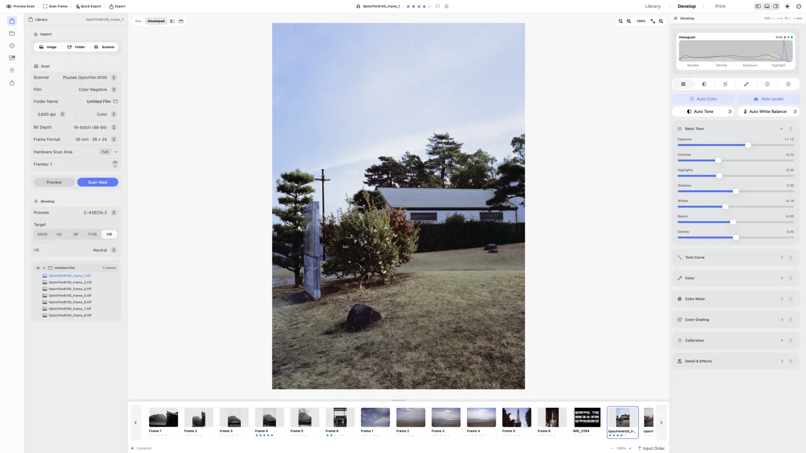
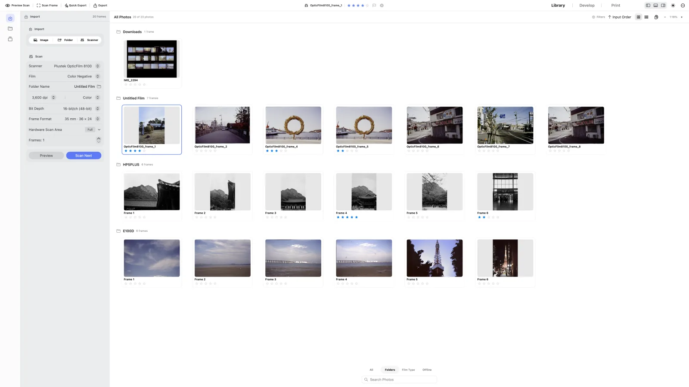
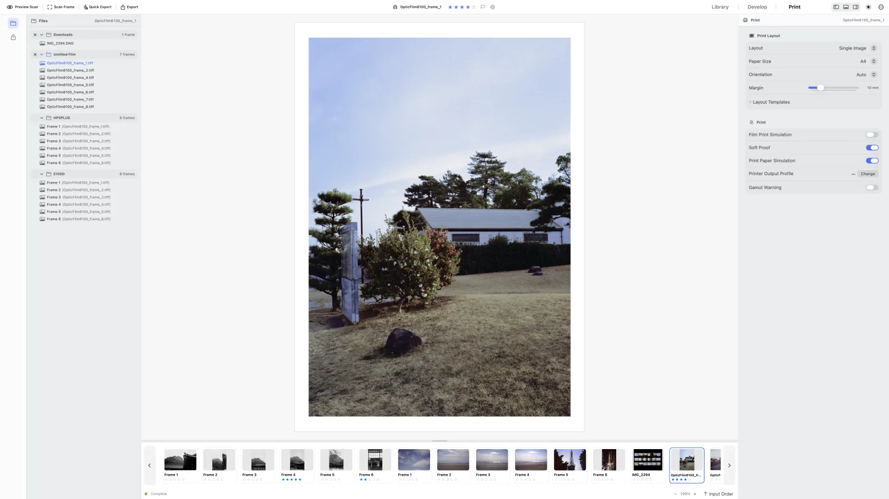

  

<h1 align="center">negaflow</h1>

From film to finished photograph. Runs natively on macOS and Windows.

  
  
  
  
  

  <strong>English</strong> ·
  <a href="README_ko.md">한국어</a> ·
  <a href="README_ja.md">日本語</a> ·
  <a href="README_zh-Hans.md">简体中文</a> ·
  <a href="README_fr.md">Français</a> ·
  <a href="README_de.md">Deutsch</a>

  <a href="https://habinsong.github.io/negaflow-site/">Website</a> ·
  <a href="https://habinsong.github.io/negaflow-site/camera-scanning/">Camera scanning guide</a> ·
  <a href="https://habinsong.github.io/negaflow-site/faq/">FAQ</a>

---

  <picture>
    <source media="(prefers-color-scheme: dark)" srcset="docs/images/en/develop-dark.webp">
    
  </picture>

**negaflow** develops film scans and camera copies, whether color or black and white, negative or positive. Library, develop and print are in one app. Adjustments are saved apart from the original file, which stays unchanged.

The develop engine is **Chroma Engine**. **GrainMend** repairs dust and scratches. Image files can be imported, developed and exported without a scanner. Scanner support needs a separate plugin.

> Unlike the way the analog revival keeps growing, the analog photography process itself is at a standstill. Unless you print it the analog way, film has to go through a conversion into digital before it finally reaches our eyes.
>
> But that whole process is grinding to a halt. Film labs and processing shops keep disappearing, and support from manufacturers and for their products keeps shrinking.
>
> This project started from the inconveniences I felt working this way and that, and from thinking it would be nice if such a feature existed. Building on what I learned and came to know while using 35mm and medium format film, I developed every last bit of it myself. At first it was a toy project I made things on while using it alone, but by now negaflow has become something more than that.
>
> In the end, what matters most is that it works well, that it's comfortable to use, that it has to be fast, and that it produces results made properly on its own. Independently developed, **negaflow** runs natively on both macOS and Windows, and I folded in the workflows of film labs and of individuals alike.
>
>
> **Celebrating this summer, the bicentennial of Niépce's first-ever photograph.** 25 July 2026.

## negaflow for macOS and Windows

| | macOS | Windows |
|---|---|---|
| Interface | SwiftUI | WinUI 3 |
| Engine | Swift + Core Image | C++ + Direct3D |
| Color management | ColorSync | Windows ICM |

The two apps are native and separate. They differ in language and implementation, and the same file gives the same picture in both. The engine is the `Chromabase` module on macOS and the `Native` module on Windows.

A shared cross-platform codebase was ruled out for speed and stability, so each OS has its own implementation written from scratch. [Platform differences](docs/platform/PLATFORM_DIFFERENCES.md) lists what is shared and what is not.

## Download

Get it from [GitHub Releases](https://github.com/habinsong/negaflow/releases).

| File | Runs on |
|---|---|
| `negaflow-1.2.6-mac-universal.pkg` | macOS 14 or later, Apple Silicon and Intel |
| `negaflow-1.2.6-mac-arm64.pkg` | macOS 14 or later, Apple Silicon only |
| `negaflow-1.2.6-win-x64.exe` | Windows 11 24H2 or later, x64 |
| `negaflow-1.2.6-win-x64-setup.zip` | Windows installer ZIP |

macOS 14, 26 and 27 are supported.

Most Macs need the Universal PKG. The same page has the Apple Silicon PKG, a DMG and a ZIP. The Mac build is signed ad hoc and is not notarized, so on first launch open System Settings, go to Privacy & Security and click Open Anyway.

The Windows installer installs into your user folder and does not ask for administrator rights. It is unsigned, so SmartScreen blocks it once; click More info, then run it. Uninstall from Control Panel. Checksums are in `SHA256SUMS.txt` on the release page.

A scanner needs a separate plugin. For SANE scanners that is [`negaflow-scanner-sane`](https://github.com/habinsong/negaflow-scanner-sane), which runs on both macOS and Windows.

## Features

> The functions that turn a film frame into a finished photograph.

- Film base measurement, and development of color and black-and-white negatives and positives
- Exposure, contrast, curves, HSL and color grading
- Sharpening, noise reduction, grain, vignette and halation
- GrainMend, for removing dust and scratches
- A library with rolls, folders, collections, ratings, stacks, virtual copies, and search by camera, lens or film
- Presets, and copy and paste, that carry the develop process, target, tone, color, detail, crop and orientation together
- Export to JPEG, PNG, 16-bit TIFF and 16-bit linear DNG, with ICC profiles and camera, lens and film records written to EXIF
- Print with eight layouts, paper preview, photo and ISO paper sizes, and C-print

## 1.2.6

- Fixed bugs in the HS, SP, F135 and HR targets and reworked their color rendering.
- From 1.2, high-efficiency NEF files are not supported in the library on macOS or Windows, because RAW processing changed.

## Chroma Engine

**Chroma Engine** inverts and develops film.

Before it develops a negative, it measures the film base in an area the light never reached. If the automatic reading is off, pick the base with the eyedropper or enter RGB values.

The default is `MAIN` with Auto Balance on. Auto Balance is a small pill switch at the right of the Target heading. It shows only for color and black-and-white negatives on MAIN (PRINT included) and CS. It matches color and brightness to the current picture, and switching it off skips that step. Auto Tone, Auto White Balance, Auto Levels and Auto Color are separate and off by default.

The other targets: `PRINT` outputs through a printer ICC profile, `HS` and `SP` follow minilab output, `F135` and `HR` follow lab equipment, `EXPIRED` rescues old film, and `CS` holds 18 custom color styles. The output color space is sRGB, Display P3, Adobe RGB or an RGB ICC profile of your own.

The order of inversion and color processing is in the [Chroma Engine doc](docs/product/CHROMA_ENGINE.md).

## GrainMend

> **GrainMend** repairs dust, pinholes, scratches and emulsion damage.

**GrainMend RGB** works in software, so it is not hardware IR.    
`Auto` scans the whole photo without any marking. Some of what it finds is false.  
`Guided` looks only inside the area you mark. It works best on dust picked up during scanning.  
`Brush` paints over spots that Auto missed.  
`Clone stamp` copies pixels from a position you choose, so you pick the texture and paint it on.  

Auto and Guided fill a defect from the surrounding texture after checking its direction and structure. A railing or a tile joint read as a scratch would be erased from the photo.

Edits stay as layers. You can change the strength, check the mask, and switch each one off or delete it. 
**GrainMend IR** adds the detection result from the infrared channel that a scanner plugin supplies to the same record.

**GrainMend IR** uses the scanner's infrared channel (IR). It is neither an implementation of Digital ICE, iSRD or SRDx nor a compatibility mode for them. How it works, and its quality and speed criteria, are in the [GrainMend doc](docs/product/GRAINMEND.md).

## From import to print

1. Import image files, or scan with an installed plugin.
2. Choose the develop process and set the scan target.
3. Adjust color and tone in Chroma Engine.
4. Apply GrainMend to the photos that need it.
5. Check with the before-and-after view and the histogram, then print or export.

Importing does not develop anything. Development starts when you pick a process and target for a folder and press **Apply**, or when you open the Develop view. A setting can start it automatically, and it is off by default.

[From library to print](docs/product/WORKFLOW.md) has a table of what each action does to your original files.

  <picture>
    <source media="(prefers-color-scheme: dark)" srcset="docs/images/en/library-dark.webp">
    
  </picture>

  <picture>
    <source media="(prefers-color-scheme: dark)" srcset="docs/images/en/print-dark.webp">
    
  </picture>

## Scanners and film profiles

negaflow uses only the resolution, bit depth, scan area, exposure and IR support that the plugin reports. It does not infer features from a scanner model name, which could switch on controls the device lacks.

SANE devices are handled by [`negaflow-scanner-sane`](https://github.com/habinsong/negaflow-scanner-sane), a separate GPL project. The plugin runs as its own process and the exchange format is JSON. **negaflow** contains no SANE code and links none.

The bundle has 15 scanner profiles. The HS and SP targets were developed from data built on 928 personal photos scanned on lab scanners.

Profiles are chosen by hand and are never applied from a scanner name.

Details are in the [film profiles doc](docs/product/FILM_PROFILES.md).

## Documentation

- [Chroma Engine](docs/product/CHROMA_ENGINE.md) | film base, inversion, color processing and develop order
- [GrainMend](docs/product/GRAINMEND.md) | defect detection and repair, IR, edit history
- [Film profiles](docs/product/FILM_PROFILES.md) | source material analysis and profile generation
- [From library to print](docs/product/WORKFLOW.md) | import, folder sync, batch develop, print
- [Product architecture](docs/architecture/PRODUCT_ARCHITECTURE.md) | app, engine, storage and export structure
- [All documentation](docs/README.md) | six languages

## Building

Tools and commands differ per platform, and each platform doc has the full procedure. [macOS](negaflow-mac/docs/README.md) needs macOS 14 or later and Xcode 26 or later. [Windows](negaflow-windows/docs/README.md) needs Windows 11 24H2, Visual Studio 2026 and the .NET 10 SDK. Repository rules are in [`CONTRIBUTING.md`](CONTRIBUTING.md).

## License

**negaflow** is released under the [Apache License 2.0](LICENSE). It is not affiliated with or sponsored by Kodak, Fujifilm, Noritsu, LaserSoft Imaging or any other trademark holder. Product names identify compatibility or measurement references. The [trademark notice](TRADEMARKS.md) has the detail.
