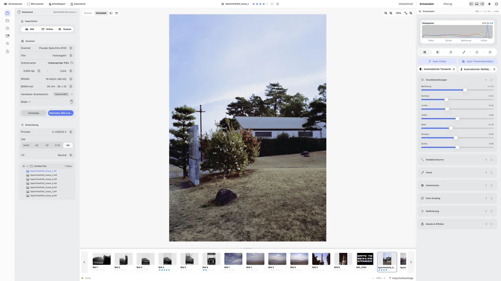
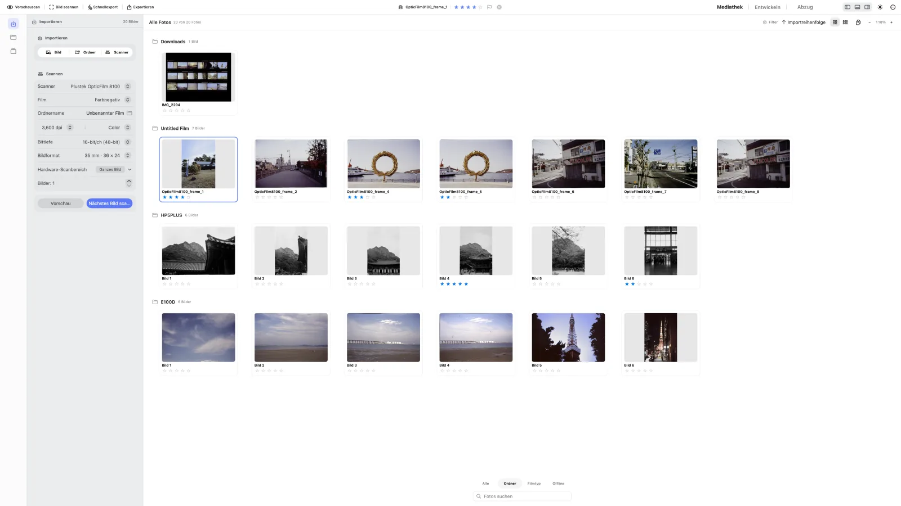
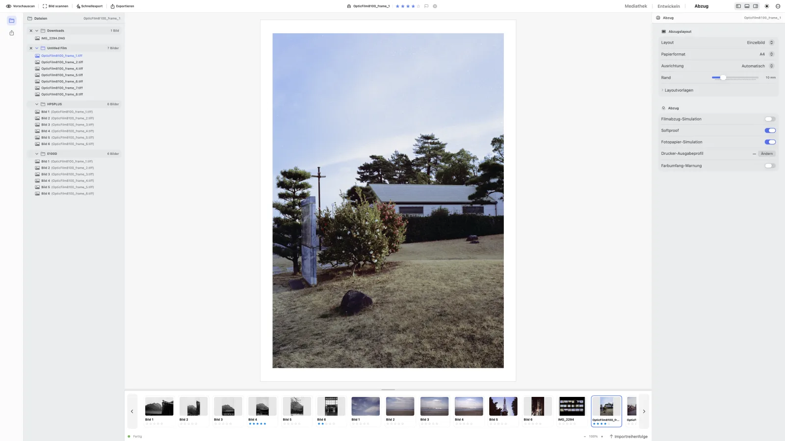

  

<h1 align="center">negaflow</h1>

Vom Film zum fertigen Foto. Läuft auf macOS und Windows jeweils nativ.

  
  
  
  
  

  <a href="README.md">English</a> ·
  <a href="README_ko.md">한국어</a> ·
  <a href="README_ja.md">日本語</a> ·
  <a href="README_zh-Hans.md">简体中文</a> ·
  <a href="README_fr.md">Français</a> ·
  <strong>Deutsch</strong>

  <a href="https://habinsong.github.io/negaflow-site/de/">Website</a> ·
  <a href="https://habinsong.github.io/negaflow-site/de/camera-scanning/">Abfotografieren mit der Kamera</a> ·
  <a href="https://habinsong.github.io/negaflow-site/de/faq/">FAQ</a>

---

  <picture>
    <source media="(prefers-color-scheme: dark)" srcset="docs/images/de/develop-dark.webp">
    
  </picture>

**negaflow** entwickelt gescannte oder mit der Kamera abfotografierte Filme: Farb- und Schwarzweißfilme, Negative und Positive. Mediathek, Entwicklung und Abzug sind in einer App vereint. Die Bearbeitungswerte werden separat gespeichert; die Originaldatei bleibt unverändert.

Die Entwicklungs-Engine heißt **Chroma Engine**. **GrainMend** repariert Staub und Kratzer. Auch ohne Scanner können Sie Bilddateien importieren, entwickeln und exportieren. Für den Scanneranschluss brauchen Sie ein separates Plug-in.

> Anders als das Wachstum der analogen Mode in letzter Zeit steckt der Prozess der analogen Fotografie derzeit fest. Solange man den Film nicht analog vergrößert, muss er den Weg der Umwandlung ins Digitale gehen, damit er uns endlich vor Augen kommt.
>
> Doch dieser ganze Ablauf kommt zum Stillstand. Filmlabore und Entwicklungsdienste verschwinden nach und nach, und die Unterstützung durch die Hersteller und für deren Produkte nimmt ab.
>
> Dieses Projekt begann mit den Unannehmlichkeiten, die ich beim Arbeiten auf die eine und die andere Weise gespürt habe, und mit dem Gedanken, dass es schön wäre, wenn es eine solche Funktion gäbe. Auf Grundlage der Erfahrung und des Wissens, die ich beim Arbeiten mit Kleinbild und Mittelformat gewonnen habe, habe ich von eins bis zehn alles selbst entwickelt. Anfangs war es ein Spielzeugprojekt, an dem ich für mich allein herumgebaut habe, doch inzwischen ist negaflow etwas mehr als das geworden.
>
> Am Ende zählt vor allem, dass es „gut“ läuft und bequem zu benutzen ist, dass es schnell sein muss, und dass am Ende ein Ergebnis steht, das von allein ordentlich gemacht wurde. Eigenständig entwickelt, läuft **negaflow** auf macOS und Windows jeweils nativ, und ich habe die Arbeitsabläufe der Filmlabore wie die der Einzelnen alle hineingeschmolzen.
>
>
> **Diesem Sommer gewidmet, dem zweihundertsten Jahr seit Niépces erster Fotografie.** 25. Juli 2026.

## negaflow for macOS and Windows

| | macOS | Windows |
|---|---|---|
| Oberfläche | SwiftUI | WinUI 3 |
| Engine | Swift + Core Image | C++ + Direct3D |
| Farbmanagement | ColorSync | Windows ICM |

Die beiden Apps sind nativ und getrennt entwickelt. Sprachen und Implementierungen unterscheiden sich, aus derselben Datei kommt dasselbe Bild. Der Engine-Code liegt unter macOS im Modul `Chromabase`, unter Windows im Modul `Native`.

Gemeinsamer plattformübergreifender Code kam aus Gründen von Geschwindigkeit und Stabilität nicht infrage. Jedes Betriebssystem hat deshalb seine eigene, von Grund auf geschriebene Implementierung. Was gleich ist und was nicht, steht in [Wo sich die macOS- und die Windows-Version unterscheiden](docs/de/platform/PLATFORM_DIFFERENCES.md).

## Download

Die Dateien liegen bei [GitHub Releases](https://github.com/habinsong/negaflow/releases).

| Datei | Umgebung |
|---|---|
| `negaflow-1.2.6-mac-universal.pkg` | macOS 14 oder neuer, Apple Silicon und Intel |
| `negaflow-1.2.6-mac-arm64.pkg` | macOS 14 oder neuer, nur Apple Silicon |
| `negaflow-1.2.6-win-x64.exe` | Windows 11 24H2 oder neuer, x64 |
| `negaflow-1.2.6-win-x64-setup.zip` | Windows-Installer-ZIP |

Kompatibel mit macOS 14, 26 und 27.

Für die meisten Macs genügt das Universal-PKG. Auf derselben Seite liegen auch das PKG nur für Apple Silicon, ein DMG und ein ZIP. Die Mac-Version ist ad hoc signiert und nicht notarisiert. Beim ersten Start öffnen Sie die Systemeinstellungen, gehen zu Datenschutz & Sicherheit und klicken einmal auf Trotzdem öffnen.

Der Windows-Installer legt die App in Ihrem Benutzerordner ab und verlangt keine Administratorrechte. Er ist nicht signiert, deshalb blockiert SmartScreen ihn einmal: Klicken Sie auf Weitere Informationen und führen Sie ihn dann aus. Deinstalliert wird über die Systemsteuerung. Prüfsummen stehen in `SHA256SUMS.txt` auf der Release-Seite.

Für einen Scanner brauchen Sie ein separates Plug-in. Für SANE-Scanner ist das [`negaflow-scanner-sane`](https://github.com/habinsong/negaflow-scanner-sane), das unter macOS und Windows läuft.

## Funktionen

> Die Funktionen, die aus analogem Film ein fertiges Foto machen.

- Messung der Filmbasis, Entwicklung von Farb- und Schwarzweißnegativen und -positiven
- Belichtung, Kontrast, Kurven, HSL und Colorgrading
- Schärfung, Rauschminderung, Korn, Vignette und Halation
- GrainMend, das Staub und Kratzer entfernt
- Eine Mediathek mit Filmen, Ordnern, Sammlungen, Bewertungen, Stapeln, virtuellen Kopien und Suche nach Kamera, Objektiv oder Film
- Vorgaben und Kopieren/Einfügen, die Entwicklungsprozess, Ziel, Tonwert, Farbe, Detail, Ausschnitt und Ausrichtung gemeinsam übertragen
- Export als JPEG, PNG, 16-Bit-TIFF und lineares 16-Bit-DNG, mit ICC-Profilen und Kamera-, Objektiv- und Filmangaben im EXIF
- Acht Abzugslayouts, Papiervorschau, Foto- und ISO-Papiergrößen und C-Print

## 1.2.6

- Fehler in den Zielen HS, SP, F135 und HR wurden behoben und ihre Farbwiedergabe neu aufgebaut.
- Ab 1.2 unterstützt die Mediathek unter macOS und Windows keine hocheffizienten NEF-Dateien, weil sich die RAW-Verarbeitung geändert hat.

## Chroma Engine

**Chroma Engine** invertiert und entwickelt den Film.

Vor der Entwicklung eines Negativs misst sie die Filmbasis in einem Bereich, den kein Licht erreicht hat. Liegt die automatische Messung daneben, wählen Sie die Basis mit der Pipette oder geben RGB-Werte ein.

Voreingestellt sind `MAIN` und Auto-Abgleich ON. Der Auto-Abgleich ist ein kleiner Pillenschalter rechts neben der Zielüberschrift. Er erscheint nur bei Farb- und S/W-Negativen mit MAIN (einschließlich PRINT) und CS. Er passt Farbe und Helligkeit an das aktuelle Bild an; bei OFF entfällt dieser Schritt. Automatische Tonwerte, Automatischer Weißabgleich, Auto-Tonwertkorrektur und Auto-Farbe sind eigene Funktionen und standardmäßig OFF.

Die übrigen Ziele: `PRINT` gibt über ein Drucker-ICC aus, `HS` und `SP` gehören zur Minilab-Familie, `F135` und `HR` zur Familie der Laborgeräte, `EXPIRED` rettet alten Film, und `CS` fasst 18 eigene Farbstile zusammen. Als Ausgabe stehen sRGB, Display P3, Adobe RGB und ein eigenes RGB-ICC zur Wahl.

Die Reihenfolge von Invertierung und Farbverarbeitung steht in der [Chroma-Engine-Dokumentation](docs/de/product/CHROMA_ENGINE.md).

## GrainMend

> **GrainMend** repariert Staub, Pinholes, Kratzer und Emulsionsschäden.

**GrainMend RGB** arbeitet per Software und ist kein Hardware-IR.    
`Automatisch` geht das ganze Foto ohne Markierung durch. Ein Teil der Funde sind Fehlerkennungen.  
`Geführt` sieht nur den angegebenen Bereich an. Am besten wirkt es auf Staub, der beim Scannen dazukommt.  
`Pinsel` übermalt Stellen, die Automatisch übersehen hat.  
`Klonstempel` kopiert die Pixel einer gewählten Position; Sie wählen die Textur und tragen sie selbst auf.  

Automatisch und Geführt füllen einen Defekt mit der umgebenden Textur, nachdem sie deren Richtung und Struktur geprüft haben. Ein Geländer oder eine Fliesenfuge, die für einen Kratzer gehalten wird, verschwindet aus dem Foto.

Die Korrekturen bleiben als Ebenen erhalten. Sie können die Stärke ändern, die Maske prüfen und jede Ebene abschalten oder löschen. 
**GrainMend IR** fügt die Erkennungsergebnisse aus dem Infrarotkanal, den ein Scanner-Plug-in liefert, demselben Verlauf hinzu.

**GrainMend IR** nutzt den Infrarotkanal (IR) des Scanners. Es ist weder eine Implementierung noch ein Kompatibilitätsmodus von Digital ICE, iSRD oder SRDx. Arbeitsweise sowie Qualitäts- und Leistungsmaßstäbe stehen in der [GrainMend-Dokumentation](docs/de/product/GRAINMEND.md).

## Vom Import zum Abzug

1. Bilddateien importieren oder mit einem installierten Plug-in scannen.
2. Den Entwicklungsprozess wählen und das Scanziel angeben.
3. Farbe und Tonwert in der Chroma Engine anpassen.
4. GrainMend auf die Fotos anwenden, die es brauchen.
5. Mit Vorher/Nachher-Ansicht und Histogramm prüfen, dann drucken oder exportieren.

Der Import entwickelt nichts. Die Entwicklung beginnt, wenn Sie für einen Ordner Prozess und Ziel wählen und **Anwenden** drücken, oder wenn Sie die Ansicht Entwickeln öffnen. Eine Einstellung kann sie automatisch starten; sie ist standardmäßig aus.

Eine Tabelle in [Von der Mediathek zum Abzug](docs/de/product/WORKFLOW.md) zeigt, was jede Aktion mit Ihren Originaldateien macht.

  <picture>
    <source media="(prefers-color-scheme: dark)" srcset="docs/images/de/library-dark.webp">
    
  </picture>

  <picture>
    <source media="(prefers-color-scheme: dark)" srcset="docs/images/de/print-dark.webp">
    
  </picture>

## Scanner und Filmprofile

negaflow benutzt nur Auflösung, Bittiefe, Scanbereich, Belichtung und IR-Unterstützung, die das Plug-in meldet. Es schließt nicht aus dem Modellnamen eines Scanners auf Funktionen, denn das könnte Bedienelemente freischalten, die das Gerät nicht hat.

SANE-Geräte übernimmt [`negaflow-scanner-sane`](https://github.com/habinsong/negaflow-scanner-sane), ein eigenständiges GPL-Projekt. Das Plug-in läuft als eigener Prozess, das Austauschformat ist JSON. In **negaflow** steckt kein SANE-Code, und es wird auch keiner eingebunden.

Im Paket sind 15 Scannerprofile enthalten. Die Ziele HS und SP wurden aus Daten entwickelt, die auf 928 privaten Fotos beruhen, gescannt auf Laborscannern.

Profile wählen Sie selbst aus. Sie werden nie anhand eines Scannernamens angewendet.

Näheres steht in der [Filmprofil-Dokumentation](docs/de/product/FILM_PROFILES.md).

## Dokumentation

- [Chroma Engine](docs/de/product/CHROMA_ENGINE.md) | Filmbasis, Invertierung, Farbverarbeitung und Entwicklungsreihenfolge
- [GrainMend](docs/de/product/GRAINMEND.md) | Defekterkennung und Reparatur, IR, Bearbeitungsverlauf
- [Filmprofile](docs/de/product/FILM_PROFILES.md) | Materialanalyse und Profilerzeugung
- [Von der Mediathek zum Abzug](docs/de/product/WORKFLOW.md) | Import, Ordnerabgleich, Stapelentwicklung, Abzug
- [Produktstruktur](docs/de/architecture/PRODUCT_ARCHITECTURE.md) | Struktur von App, Engine, Speicherung und Export
- [Die ganze Dokumentation](docs/de/README.md) | 6 Sprachen

## Selbst bauen

Werkzeuge und Befehle unterscheiden sich je Plattform, und die jeweilige Dokumentation hat den vollständigen Ablauf. [macOS](negaflow-mac/docs/README_de.md) braucht macOS 14 oder neuer und Xcode 26 oder neuer. [Windows](negaflow-windows/docs/README_de.md) braucht Windows 11 24H2, Visual Studio 2026 und das .NET 10 SDK. Die Arbeitsregeln für das Repository stehen in [`CONTRIBUTING.md`](CONTRIBUTING.md).

## Lizenz

**negaflow** wird unter der [Apache-Lizenz 2.0](LICENSE) veröffentlicht. Es steht in keiner Verbindung zu Kodak, Fujifilm, Noritsu, LaserSoft Imaging oder einem anderen Markeninhaber und wird von ihnen nicht gesponsert. Produktnamen bezeichnen nur, womit etwas kompatibel ist oder woran es gemessen wurde. Die [Markenhinweise](TRADEMARKS.md) nennen die Einzelheiten.
