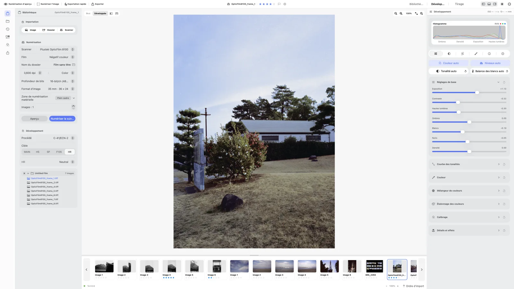
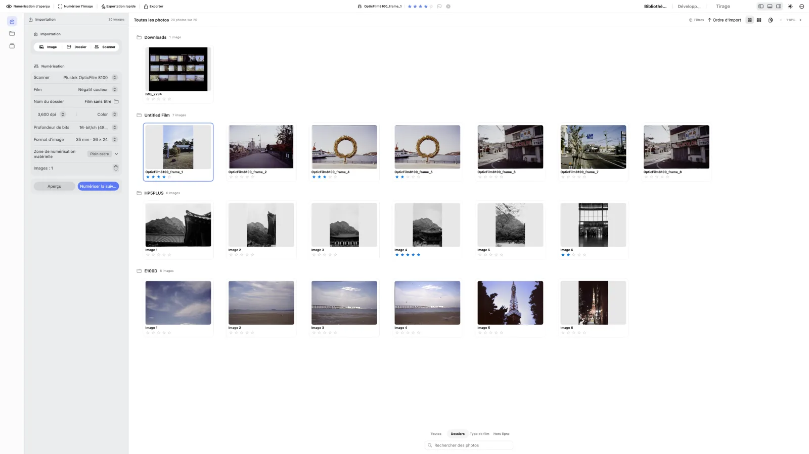
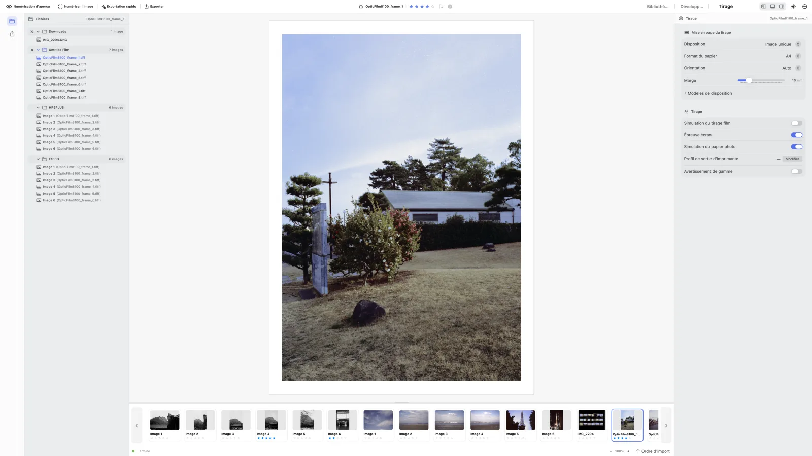

  

<h1 align="center">negaflow</h1>

De la pellicule à la photographie finie. Fonctionne nativement sur macOS et Windows.

  
  
  
  
  

  <a href="README.md">English</a> ·
  <a href="README_ko.md">한국어</a> ·
  <a href="README_ja.md">日本語</a> ·
  <a href="README_zh-Hans.md">简体中文</a> ·
  <strong>Français</strong> ·
  <a href="README_de.md">Deutsch</a>

  <a href="https://habinsong.github.io/negaflow-site/fr/">Site web</a> ·
  <a href="https://habinsong.github.io/negaflow-site/fr/camera-scanning/">Guide de reproduction au boîtier</a> ·
  <a href="https://habinsong.github.io/negaflow-site/fr/faq/">FAQ</a>

---

  <picture>
    <source media="(prefers-color-scheme: dark)" srcset="docs/images/fr/develop-dark.webp">
    
  </picture>

**negaflow** développe les pellicules numérisées ou reproduites au boîtier, en couleur ou en noir et blanc, négatives ou positives. Vous pouvez organiser, développer et tirer vos photos dans la même application. Les réglages sont enregistrés séparément ; le fichier d'origine reste intact.

Le moteur de développement s'appelle **Chroma Engine**. **GrainMend** répare les poussières et les rayures. Sans scanner, vous pouvez importer des fichiers image, les développer et les exporter. La connexion à un scanner nécessite un module séparé.

> Contrairement à la façon dont l'engouement pour l'argentique continue de croître, le processus de la photographie argentique, lui, est à l'arrêt. À moins de tirer la pellicule à la manière argentique, il faut passer par une conversion en numérique pour qu'elle parvienne enfin à nos yeux.
>
> Or tout ce processus est en train de s'arrêter. Les laboratoires et les boutiques de développement disparaissent peu à peu, et le soutien des fabricants et de leurs produits diminue.
>
> Ce projet est né des désagréments ressentis en travaillant d'une manière puis d'une autre, et de l'idée qu'il serait bien qu'une telle fonction existe. En m'appuyant sur l'expérience et les connaissances acquises en utilisant la pellicule 35 mm et le moyen format, j'ai tout développé moi-même de A à Z. Au début c'était un projet-jouet que je bricolais en m'en servant seul, mais aujourd'hui negaflow est devenu quelque chose de plus que cela.
>
> Au fond, ce qui compte avant tout, c'est que ça marche « bien », que ce soit confortable à utiliser, que ce soit rapide, et que le résultat soit fait correctement tout seul. Développé de façon indépendante, **negaflow** fonctionne nativement sur macOS comme sur Windows, et j'y ai fondu à la fois les manières de faire des laboratoires et celles des particuliers.
>
>
> **En hommage, cet été, au bicentenaire de la première photographie de Niépce.** 25 juillet 2026.

## negaflow for macOS and Windows

| | macOS | Windows |
|---|---|---|
| Interface | SwiftUI | WinUI 3 |
| Moteur | Swift + Core Image | C++ + Direct3D |
| Gestion des couleurs | ColorSync | Windows ICM |

Les deux applications sont natives et distinctes. Les langages et les implémentations diffèrent, et le même fichier donne la même image dans les deux. Le moteur est le module `Chromabase` sur macOS et le module `Native` sur Windows.

Un code multiplateforme commun a été écarté pour la vitesse et la stabilité. Chaque système a donc sa propre implémentation, écrite de zéro. Ce qui est commun et ce qui diffère est détaillé dans [Ce qui diffère entre les versions macOS et Windows](docs/fr/platform/PLATFORM_DIFFERENCES.md).

## Téléchargement

Les fichiers sont sur [GitHub Releases](https://github.com/habinsong/negaflow/releases).

| Fichier | Environnement |
|---|---|
| `negaflow-1.2.6-mac-universal.pkg` | macOS 14 ou ultérieur, Apple Silicon et Intel |
| `negaflow-1.2.6-mac-arm64.pkg` | macOS 14 ou ultérieur, Apple Silicon uniquement |
| `negaflow-1.2.6-win-x64.exe` | Windows 11 24H2 ou plus récent, x64 |
| `negaflow-1.2.6-win-x64-setup.zip` | ZIP du programme d’installation Windows |

Compatible avec macOS 14, 26 et 27.

La plupart des Mac utilisent le PKG Universal. La même page propose aussi le PKG réservé à Apple Silicon, un DMG et un ZIP. La version Mac est signée en ad hoc et n'est pas notariée : au premier lancement, ouvrez Réglages Système, allez dans Confidentialité et sécurité et cliquez une fois sur Ouvrir quand même.

Le programme d'installation Windows s'installe dans votre dossier utilisateur et ne demande pas de droits administrateur. Il n'est pas signé, donc SmartScreen le bloque une fois : cliquez sur Informations complémentaires, puis exécutez-le. La désinstallation se fait depuis le Panneau de configuration. Les sommes de contrôle sont dans `SHA256SUMS.txt`, sur la page de la version.

Un scanner demande un module séparé. Pour les scanners SANE, c'est [`negaflow-scanner-sane`](https://github.com/habinsong/negaflow-scanner-sane), qui fonctionne sur macOS et Windows.

## Fonctions

> Les fonctions qui font d'une pellicule argentique une photographie finie.

- Mesure de la base du film, développement des négatifs et positifs couleur et noir et blanc
- Exposition, contraste, courbes, TSL et étalonnage
- Accentuation, réduction de bruit, grain, vignetage et halation
- GrainMend, qui retire poussières et rayures
- Une bibliothèque avec bobines, dossiers, collections, notes, piles, copies virtuelles, et recherche par boîtier, objectif ou film
- Des préréglages et un copier-coller qui emportent ensemble procédé, cible, tonalité, couleur, détail, recadrage et orientation
- Export JPEG, PNG, TIFF 16 bits et DNG linéaire 16 bits, profils ICC, et boîtier, objectif et film inscrits dans l'EXIF
- Huit mises en page d'impression, aperçus de papier, formats photo et ISO, et C-print

## 1.2.6

- Les cibles HS, SP, F135 et HR ont été corrigées et leur rendu des couleurs refait.
- Depuis la version 1.2, la bibliothèque ne prend pas en charge les fichiers NEF haute efficacité, sur Mac comme sur Windows, car le traitement RAW a changé.

## Chroma Engine

**Chroma Engine** s'occupe de l'inversion et du développement de la pellicule.

Avant de développer un négatif, il mesure la base du film dans une zone que la lumière n'a pas touchée. Si la mesure automatique tombe à côté, choisissez la base à la pipette ou saisissez les valeurs RVB.

Par défaut, la cible est `MAIN` avec Équilibre auto sur ON. Équilibre auto est une petite pastille à droite du titre Cible. Elle n'apparaît que pour les négatifs couleur et noir et blanc avec MAIN (y compris PRINT) et CS. Elle ajuste la couleur et la luminosité d'après la photo actuelle ; sur OFF, cette étape est sautée. Tonalité auto, balance des blancs automatique, niveaux auto et couleur auto sont des fonctions distinctes, désactivées par défaut.

Les autres cibles : `PRINT` pour la sortie via un profil ICC d'imprimante, `HS` et `SP` pour la famille minilab, `F135` et `HR` pour la famille des équipements de laboratoire, `EXPIRED` pour rattraper les vieux films, et `CS`, qui réunit 18 styles de couleur personnalisés. La sortie se fait en sRGB, Display P3, Adobe RGB ou avec un profil ICC RVB de votre choix.

L'ordre de l'inversion et du traitement des couleurs est dans la [documentation Chroma Engine](docs/fr/product/CHROMA_ENGINE.md).

## GrainMend

> **GrainMend** répare poussières, micro-trous, rayures et dégâts d'émulsion.

**GrainMend RGB** est une approche logicielle et ne remplace pas l'IR matériel.    
`Automatique` balaie toute la photo sans repère. Une partie de ce qu'il trouve est de fausses détections.  
`Guidé` ne regarde que la zone indiquée. Il agit le mieux sur la poussière ramassée pendant la numérisation.  
`Pinceau` peint les endroits qu'Automatique a manqués.  
`Tampon de clonage` copie les pixels d'une position choisie : vous choisissez la texture et vous la peignez.  

Automatique et Guidé comblent un défaut avec la texture environnante, après en avoir examiné la direction et la structure. Une rambarde ou un joint de carrelage pris pour une rayure serait effacé de la photo.

Les corrections restent sous forme de calques. Vous pouvez changer l'intensité, vérifier le masque, et désactiver ou supprimer chaque calque. 
**GrainMend IR** ajoute au même relevé les résultats de détection du canal infrarouge transmis par un module scanner.

**GrainMend IR** utilise le canal infrarouge (IR) du scanner. Ce n'est ni une implémentation ni un mode de compatibilité de Digital ICE, iSRD ou SRDx. Le fonctionnement ainsi que les critères de qualité et de performance sont dans la [documentation GrainMend](docs/fr/product/GRAINMEND.md).

## De l'import au tirage

1. Importez des fichiers image, ou numérisez avec un module installé.
2. Choisissez le procédé de développement et indiquez la cible de numérisation.
3. Ajustez la couleur et la tonalité dans Chroma Engine.
4. Appliquez GrainMend aux photos qui en ont besoin.
5. Vérifiez avec la vue avant/après et l'histogramme, puis tirez ou exportez.

Importer ne développe rien. Le développement démarre quand vous choisissez un procédé et une cible pour un dossier et appuyez sur **Appliquer**, ou quand vous ouvrez la vue Développement. Un réglage permet de le lancer automatiquement ; il est désactivé par défaut.

Un tableau de [De la bibliothèque au tirage](docs/fr/product/WORKFLOW.md) indique ce que chaque action fait à vos fichiers d'origine.

  <picture>
    <source media="(prefers-color-scheme: dark)" srcset="docs/images/fr/library-dark.webp">
    
  </picture>

  <picture>
    <source media="(prefers-color-scheme: dark)" srcset="docs/images/fr/print-dark.webp">
    
  </picture>

## Scanners et profils de film

negaflow n'utilise que la résolution, la profondeur, la zone de numérisation, l'exposition et le support IR que le module déclare. Il ne déduit aucune fonction du nom de modèle d'un scanner, ce qui pourrait activer des commandes absentes de l'appareil.

Les appareils SANE sont pris en charge par [`negaflow-scanner-sane`](https://github.com/habinsong/negaflow-scanner-sane), un projet GPL séparé. Le module tourne dans son propre processus et le format d'échange est JSON. **negaflow** ne contient aucun code SANE et n'en lie aucun.

Le paquet contient 15 profils de scanner. Les cibles HS et SP ont été développées à partir de données tirées de 928 photos personnelles numérisées sur des scanners de laboratoire.

Les profils se choisissent à la main et ne s'appliquent jamais d'après un nom de scanner.

Le détail est dans la [documentation des profils de film](docs/fr/product/FILM_PROFILES.md).

## Documentation

- [Chroma Engine](docs/fr/product/CHROMA_ENGINE.md) | base du film, inversion, traitement des couleurs et ordre de développement
- [GrainMend](docs/fr/product/GRAINMEND.md) | détection et réparation des défauts, IR, historique des retouches
- [Profils de film](docs/fr/product/FILM_PROFILES.md) | analyse des sources et génération des profils
- [De la bibliothèque au tirage](docs/fr/product/WORKFLOW.md) | import, synchronisation des dossiers, développement par lot, impression
- [Architecture produit](docs/fr/architecture/PRODUCT_ARCHITECTURE.md) | structure de l'application, du moteur, du stockage et de l'export
- [Toute la documentation](docs/fr/README.md) | 6 langues

## Compiler soi-même

Les outils et les commandes diffèrent selon la plateforme, et chaque documentation donne la procédure complète. [macOS](negaflow-mac/docs/README_fr.md) demande macOS 14 ou ultérieur et Xcode 26 ou ultérieur. [Windows](negaflow-windows/docs/README_fr.md) demande Windows 11 24H2, Visual Studio 2026 et le SDK .NET 10. Les règles de travail du dépôt sont dans [`CONTRIBUTING.md`](CONTRIBUTING.md).

## Licence

**negaflow** est distribué sous [licence Apache 2.0](LICENSE). Il n'est ni affilié ni sponsorisé par Kodak, Fujifilm, Noritsu, LaserSoft Imaging ni aucun autre détenteur de marque. Les noms de produits ne servent qu'à désigner une compatibilité ou une référence de mesure. La [note sur les marques](TRADEMARKS.md) donne le détail.
