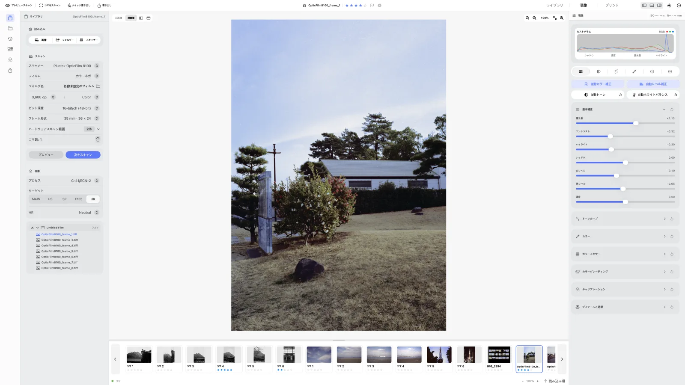
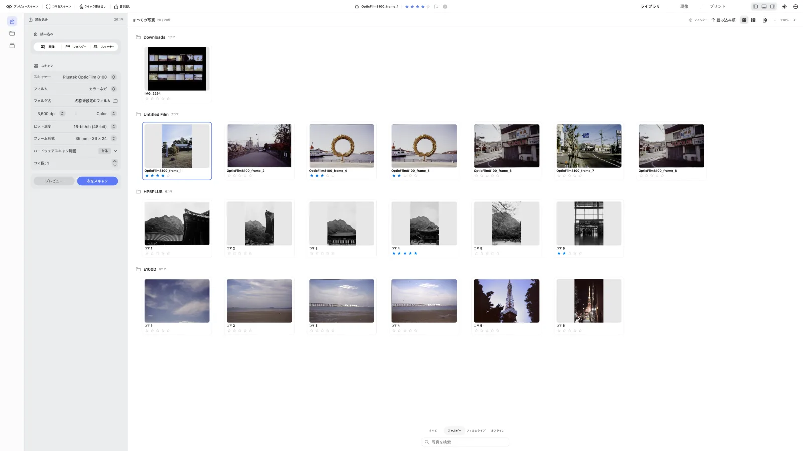
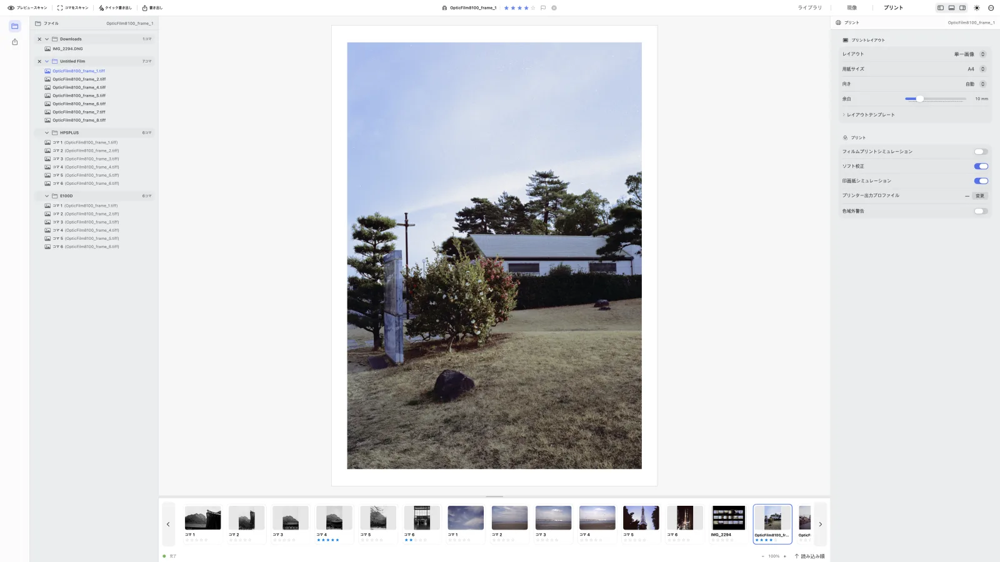

  

<h1 align="center">negaflow</h1>

フィルムから完成した写真まで。macOS と Windows でそれぞれネイティブに動きます。

  
  
  
  
  

  <a href="README.md">English</a> ·
  <a href="README_ko.md">한국어</a> ·
  <strong>日本語</strong> ·
  <a href="README_zh-Hans.md">简体中文</a> ·
  <a href="README_fr.md">Français</a> ·
  <a href="README_de.md">Deutsch</a>

  <a href="https://habinsong.github.io/negaflow-site/ja/">ウェブサイト</a> ·
  <a href="https://habinsong.github.io/negaflow-site/ja/camera-scanning/">カメラスキャンガイド</a> ·
  <a href="https://habinsong.github.io/negaflow-site/ja/faq/">FAQ</a>

---

  <picture>
    <source media="(prefers-color-scheme: dark)" srcset="docs/images/ja/develop-dark.webp">
    
  </picture>

**negaflow** は、スキャンしたフィルムやカメラで複写したフィルムを読み込んで現像するアプリです。カラーと白黒、ネガとポジのどれにも対応し、ライブラリから現像、プリントまでアプリひとつで済みます。補正の値は元のファイルとは別に保存するので、元のファイルは変わりません。

現像エンジンは **Chroma Engine**、ゴミやキズの修復は **GrainMend** です。スキャナーがなくても、画像ファイルを読み込んで現像し、書き出せます。スキャナー接続は、プラグインを別に入れたときだけ使えます。

> 最近のアナログ流行の伸びとは違って、今のアナログ写真のプロセスは停滞期と言えます。フィルムをアナログでプリントする方法でない限り、アナログをデジタルに変換する過程を経てはじめて私たちの目に見えます。
>
> ところが、その過程のすべてが止まりかけています。フィルムラボや現像所はどんどんなくなり、メーカーと製品への支えが減っているからです。
>
> 本プロジェクトは、あれこれのやり方で作業しながら感じた不便と、こんな機能があればいいという考えから始まりました。35mm フィルムと中判フィルムを使いながら知った経験と知識をもとに、一から十まで全部自分で開発しました。最初は自分ひとりで使いながらいろいろ作ってみたトイプロジェクトでしたが、今の negaflow はそれ以上の何かになりました。
>
> 結局のところ何よりも「ちゃんと」動いて楽に使えて、速くなければならず、何でも勝手にきちんと作った結果物が大事ですから。独自開発した **negaflow** は macOS と Windows でそれぞれネイティブに動き、フィルムラボと個人のワークフローを全部溶かし込んでみました。
>
>
> **ニエプスが撮った最初の写真から200周年になる今年の夏を記念して。** 2026年7月25日。

## negaflow for macOS and Windows

| | macOS | Windows |
|---|---|---|
| 画面 | SwiftUI | WinUI 3 |
| エンジン | Swift + Core Image | C++ + Direct3D |
| カラーマネジメント | ColorSync | Windows ICM |

二つのアプリはそれぞれネイティブで、別々に作っています。言語も実装も違いますが、同じファイルからは同じ絵になります。エンジンのコードは macOS では `Chromabase`、Windows では `Native` モジュールにあります。

クロスプラットフォームの共通コードは、速度と安定性の面で採用せず、OS ごとに最初から別々に実装しました。共通点と相違点は[macOS 版と Windows 版の違い](docs/ja/platform/PLATFORM_DIFFERENCES.md)にまとめてあります。

## ダウンロード

[GitHub Releases](https://github.com/habinsong/negaflow/releases) から入手します。

| インストーラー | 対象 |
|---|---|
| `negaflow-1.2.6-mac-universal.pkg` | macOS 14 以降、Apple Silicon と Intel |
| `negaflow-1.2.6-mac-arm64.pkg` | macOS 14 以降、Apple Silicon のみ |
| `negaflow-1.2.6-win-x64.exe` | Windows 11 24H2 以降、x64 |
| `negaflow-1.2.6-win-x64-setup.zip` | Windows インストーラー ZIP |

macOS 14、26、27 に対応しています。

ほとんどの Mac では Universal PKG を使います。同じページに Apple Silicon 専用の PKG、DMG、ZIP もあります。Mac 版は ad hoc 署名で、Apple の公証は受けていません。初回起動のときは、システム設定のプライバシーとセキュリティで「このまま開く」を一度押してください。

Windows のインストーラーはユーザーフォルダーに入り、管理者権限を求めません。署名がないため、SmartScreen が一度止めます。詳細情報を押してから実行してください。削除はコントロールパネルから行います。チェックサムはリリースページの `SHA256SUMS.txt` にあります。

スキャナーをつなぐにはプラグインが別に必要です。SANE スキャナーには [`negaflow-scanner-sane`](https://github.com/habinsong/negaflow-scanner-sane) があり、macOS と Windows のどちらでも動きます。

## 機能

> アナログフィルムを完成した写真にするための機能です。

- フィルムベースの測定と、カラー・白黒のネガ・ポジの現像
- 露出、コントラスト、カーブ、HSL、カラーグレーディング
- シャープネス、ノイズ除去、粒子、周辺光量、ハレーション
- ゴミとキズを取り除く GrainMend
- ロール、フォルダー、コレクション、レーティング、スタック、仮想コピーと、カメラ・レンズ・フィルムでの検索を備えたライブラリ
- 現像プロセス、ターゲット、トーン、色、ディテール、切り抜き、向きをまとめて移せるプリセットとコピー・ペースト
- JPEG、PNG、16bit TIFF、16bit リニア DNG の書き出し、ICC プロファイル、EXIF に書き込むカメラ・レンズ・フィルムの記録
- 8種類のプリントレイアウト、用紙プレビュー、写真用・ISO 用紙、C-print

## 1.2.6

- HS、SP、F135、HR ターゲットのバグを修正し、色の描画を作り直しました。
- 1.2 から RAW 処理が変わったため、macOS・Windows ともにライブラリでは高効率 NEF をサポートしません。

## Chroma Engine

**Chroma Engine** はフィルムの反転と現像を受け持ちます。

ネガを現像する前に、光の当たっていない領域でフィルムベースを測ります。自動測定がずれたときは、スポイトで取るか RGB 値を直接入力します。

初期値は `MAIN` と自動バランス ON です。自動バランスは、ターゲット見出しの右にある小さなピル型スイッチで切り替えます。カラー・白黒ネガの MAIN（PRINT を含む）と CS でのみ表示されます。現在の写真に合わせて色と明るさを整え、OFF にするとこの処理を省きます。自動トーン、自動ホワイトバランス、自動レベル補正、自動カラー補正は別の機能で、初期値は OFF です。

そのほかのターゲットは、プリンターの ICC で出力する `PRINT`、ミニラボ系の `HS` と `SP`、ラボ機材系の `F135` と `HR`、古いフィルムを救う `EXPIRED`、18種類のカラースタイルをまとめた `CS` です。出力の色空間は sRGB、Display P3、Adobe RGB、自分で用意した RGB ICC から選びます。

反転と色処理の順序は [Chroma Engine のドキュメント](docs/ja/product/CHROMA_ENGINE.md)にあります。

## GrainMend

> **GrainMend** はゴミ、ピンホール、キズ、乳剤の傷みを復元します。

**GrainMend RGB** はソフトウェア方式で、ハードウェアの IR とは別のものです。    
`自動` は印を付けずに写真全体を見ます。見つけたものの一部は誤検出です。  
`ガイド` は指定した領域だけを見ます。スキャン中に付いたゴミにいちばん合います。  
`ブラシ` は自動が取りこぼした場所を自分で塗ります。  
`クローンスタンプ` は選んだ位置の画素をコピーし、好みの質感を選んで塗ります。  

自動とガイドは、周辺の質感の向きと構造を確認してから、その質感で欠陥を埋めます。手すりや目地をキズと読み違えると、写真から消えてしまいます。

修正結果はレイヤーとして残ります。強さを変え、マスクを確かめ、ひとつずつ切ったり消したりできます。 
**GrainMend IR** は、スキャナープラグインから渡された赤外チャンネルの検出結果を同じ記録に足します。

**GrainMend IR** はスキャナーの赤外チャンネル(IR)を使います。Digital ICE、iSRD、SRDx の実装でも互換モードでもありません。動作の仕組みと品質・性能の基準は [GrainMend のドキュメント](docs/ja/product/GRAINMEND.md)にあります。

## 読み込みからプリントまで

1. 画像ファイルを読み込むか、導入済みのプラグインでスキャンします。
2. 現像プロセスを選び、スキャンターゲットを指定します。
3. Chroma Engine で色とトーンを調整します。
4. 必要な写真に GrainMend を適用します。
5. 比較表示とヒストグラムで確認してから、プリントまたは書き出しをします。

読み込んだだけでは現像しません。フォルダーのプロセスとターゲットを選んで**適用**を押したとき、または現像画面を開いたときに始まります。自動で始める設定も別にありますが、初期値はオフです。

各操作が元のファイルに何をするかは、[ライブラリからプリントまで](docs/ja/product/WORKFLOW.md)に表でまとめてあります。

  <picture>
    <source media="(prefers-color-scheme: dark)" srcset="docs/images/ja/library-dark.webp">
    
  </picture>

  <picture>
    <source media="(prefers-color-scheme: dark)" srcset="docs/images/ja/print-dark.webp">
    
  </picture>

## スキャナーとフィルムプロファイル

negaflow は、プラグインが報告した解像度、ビット深度、スキャン領域、露出、IR 対応だけを使います。スキャナーの機種名から機能を推測することはありません。推測すると、装置にない機能が有効になるおそれがあるためです。

SANE 機器は、別の GPL プロジェクトである [`negaflow-scanner-sane`](https://github.com/habinsong/negaflow-scanner-sane) が担当します。プラグインは別プロセスで動き、やり取りの形式は JSON です。**negaflow** に SANE のコードは入っておらず、リンクもしていません。

スキャナープロファイルを15個同梱しています。ラボ用スキャナーでスキャンした個人の写真928枚をもとに作ったデータで、HS と SP ターゲットを開発しました。

プロファイルは自分で選ぶもので、スキャナー名から自動では当たりません。

詳しくは[フィルムプロファイルのドキュメント](docs/ja/product/FILM_PROFILES.md)にあります。

## ドキュメント

- [Chroma Engine](docs/ja/product/CHROMA_ENGINE.md) | フィルムベース、反転、色処理と現像の順序
- [GrainMend](docs/ja/product/GRAINMEND.md) | 欠陥の検出と復元、IR、編集記録
- [フィルムプロファイル](docs/ja/product/FILM_PROFILES.md) | 撮影資料の分析とプロファイル生成
- [ライブラリからプリントまで](docs/ja/product/WORKFLOW.md) | 読み込み、フォルダー同期、一括現像、プリント
- [製品構造](docs/ja/architecture/PRODUCT_ARCHITECTURE.md) | アプリ、エンジン、保存と書き出しの構造
- [ドキュメント全体](docs/ja/README.md) | 6言語

## 自分でビルドする

必要な道具とコマンドはプラットフォームごとに違い、全手順は各ドキュメントにあります。[macOS](negaflow-mac/docs/README_ja.md) は macOS 14 以降と Xcode 26 以降が必要です。[Windows](negaflow-windows/docs/README_ja.md) は Windows 11 24H2、Visual Studio 2026、.NET 10 SDK が必要です。リポジトリでの作業ルールは [`CONTRIBUTING.md`](CONTRIBUTING.md) にあります。

## ライセンス

**negaflow** は [Apache License 2.0](LICENSE) で配布します。Kodak、Fujifilm、Noritsu、LaserSoft Imaging をはじめ、どの商標権者とも提携や後援を受けていません。製品名は、互換の対象や測定の対象を指すときだけ使います。詳しくは[商標について](TRADEMARKS.md)にあります。
