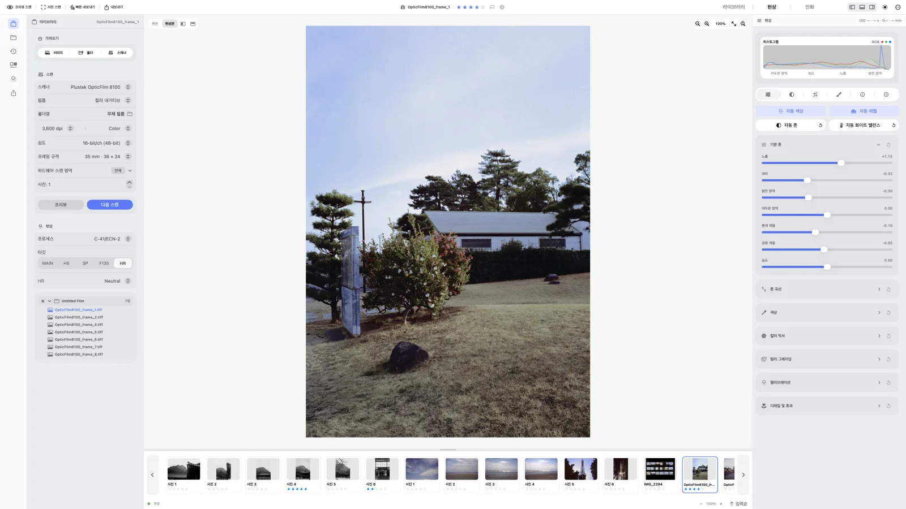
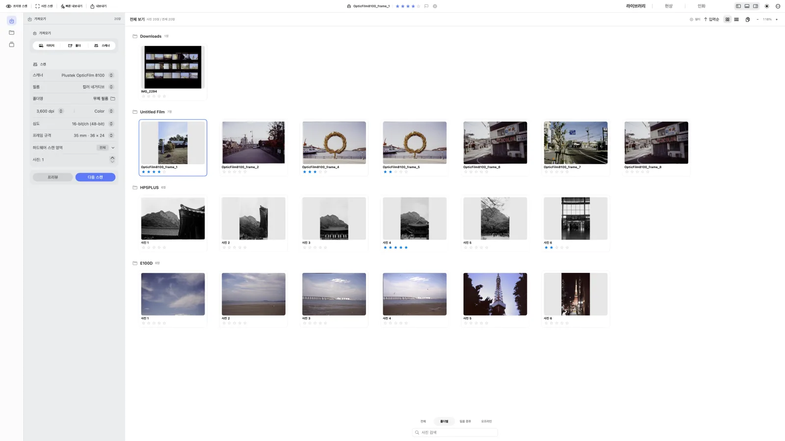
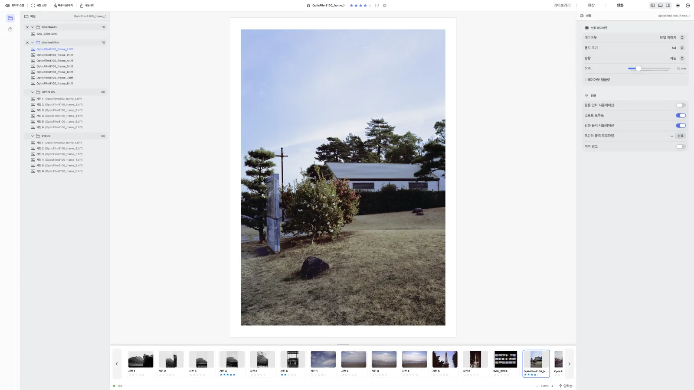

  

<h1 align="center">negaflow</h1>

필름에서 완성된 사진까지. macOS와 Windows에서 네이티브로 동작합니다.

  
  
  
  
  

  <a href="README.md">English</a> ·
  <strong>한국어</strong> ·
  <a href="README_ja.md">日本語</a> ·
  <a href="README_zh-Hans.md">简体中文</a> ·
  <a href="README_fr.md">Français</a> ·
  <a href="README_de.md">Deutsch</a>

  <a href="https://habinsong.github.io/negaflow-site/ko/">웹사이트</a> ·
  <a href="https://habinsong.github.io/negaflow-site/ko/camera-scanning/">카메라 스캔 가이드</a> ·
  <a href="https://habinsong.github.io/negaflow-site/ko/faq/">FAQ</a>

---

  <picture>
    <source media="(prefers-color-scheme: dark)" srcset="docs/images/ko/develop-dark.webp">
    
  </picture>

**negaflow**는 스캔한 필름이나 카메라로 촬영한 필름을 가져와서 현상하는 앱입니다. 칼라와 흑백도,
네거티브와 포지티브도 다 지원하며, 라이브러리에서 현상, 인화까지 앱에서 다 가능합니다. 아날로그 필름을 눈에 보이는 완성된 이미지로 만들어주는 모든 기능이 다 포함되어 있습니다.

현상 엔진 이름은 **Chroma Engine**, 먼지와 스크래치 복원은 **GrainMend**입니다. 스캐너가 없어도
괜찮습니다. 이미지 파일만 가져와도 현상하고 내보낼 수 있으며, 스캐너 연결은 플러그인을 따로 깔았을
때만 열립니다.

> 요즘의 아날로그 유행의 성장과 다르게 지금의 아날로그 사진 프로세스는 정체기라고 할 수 있죠.
> 필름을 아날로그 인화하는 방식이 아닌 이상, 아날로그를 디지털로 변환하는 과정을 거쳐야 비로소 우리
> 눈에 보입니다.
>
> 그러나 그 모든 과정이 멈춰가고 있습니다. 필름랩, 현상소는 점점 없어져 제조사와 제품 지원이 줄어들고 있기 때문이죠.
>
> 본 프로젝트는 이런저런 방식으로 작업해 보며 느낀 불편함과, 이런 기능이 있었으면 좋겠다는 생각에서
> 시작했습니다. 35mm 필름과 중형 필름을 사용하면서 알게 된 경험과 지식을 바탕으로 하나부터 열까지
> 모두 직접 개발했습니다. 처음에는 내가 혼자 사용하며 이것저것 만들어본 토이 프로젝트였지만 이제
> negaflow는 그 이상의 어떤 무언가가 되었습니다.
>
> 결국 무엇보다 '잘' 되며 편하게 사용하고, 빨라야 하고 뭐든지 알아서 제대로 만든 결과물이
> 중요하니까요. 독자 개발한 **negaflow**는 macOS와 Windows에서 각각 네이티브로 동작하고, 필름랩과 개인의 워크플로우를 다 녹여봤습니다.
>
>
> **니엡스가 찍은 최초의 사진으로부터 200주년인 올해 여름을 기념하며.**
> 2026년 7월 25일.

## negaflow for macOS and Windows

| | macOS | Windows |
|---|---|---|
| 화면 | SwiftUI | WinUI 3 |
| 엔진 | Swift + Core Image | C++ + Direct3D |
| 색 관리 | ColorSync | Windows ICM |

두 앱은 각각 네이티브로 따로 만들었습니다. 언어와 구현 방식은 다르고 같은 파일을 넣으면 같은 결과가 나옵니다. 엔진 코드는 macOS에서는 `Chromabase`, Windows에서는 `Native` 모듈에 있습니다.

크로스플랫폼 코드베이스는 속도와 안정성 때문에 택하지 않았고 OS마다 처음부터 따로 구현했습니다. 같은 부분과 다른 부분은 [플랫폼 차이](docs/ko/platform/PLATFORM_DIFFERENCES.md)에 정리했습니다.

## 다운로드

[GitHub Releases](https://github.com/habinsong/negaflow/releases)에서 받습니다.

| 설치 파일 | 사용 환경 |
|---|---|
| `negaflow-1.2.6-mac-universal.pkg` | macOS 14 이상, Apple Silicon과 Intel |
| `negaflow-1.2.6-mac-arm64.pkg` | macOS 14 이상, Apple Silicon 전용 |
| `negaflow-1.2.6-win-x64.exe` | Windows 11 24H2 이상, x64 |
| `negaflow-1.2.6-win-x64-setup.zip` | Windows 설치 파일 ZIP |

macOS 14, 26, 27과 호환됩니다.

대부분의 Mac에는 Universal PKG를 쓰면 됩니다. 같은 페이지에 Apple Silicon 전용 PKG, DMG, ZIP도 있습니다. Mac 빌드는 ad hoc 서명이고 Apple 공증은 받지 않았습니다. 처음 실행할 때 시스템 설정의 개인정보 보호 및 보안에서 '그래도 열기'를 한 번 눌러야 합니다.

Windows 설치 파일은 사용자 폴더에 설치하고 관리자 권한을 묻지 않습니다. 서명이 없어서 SmartScreen이 한 번 막습니다. 추가 정보를 누른 뒤 실행하세요. 제거는 제어판에서 합니다. 체크섬은 릴리스 페이지의 `SHA256SUMS.txt`에 있습니다.

스캐너를 연결하려면 플러그인이 따로 필요합니다. SANE 스캐너는 [`negaflow-scanner-sane`](https://github.com/habinsong/negaflow-scanner-sane)을 쓰며 macOS와 Windows 모두에서 동작합니다.

## 기능

> 아날로그 필름을 완성된 사진으로 만드는 데 필요한 기능입니다.

- 필름 베이스 측정, 컬러·흑백 네거티브와 포지티브 현상
- 노출, 대비, 커브, HSL, 컬러 그레이딩
- 선명도, 노이즈 제거, 그레인, 비네팅, 할레이션
- 먼지와 스크래치를 지우는 GrainMend
- 롤, 폴더, 컬렉션, 별점, 스택, 가상 사본을 갖춘 라이브러리와 카메라·렌즈·필름 검색
- 현상 프로세스, 타깃, 톤, 색, 디테일, 크롭, 방향을 함께 옮기는 프리셋과 복사·붙여넣기
- JPEG, PNG, 16비트 TIFF, 16비트 선형 DNG 내보내기, ICC 프로파일, EXIF에 기록하는 카메라·렌즈·필름 정보
- 8가지 인화 레이아웃, 용지 미리보기, 사진용·ISO 용지, C-print

## 1.2.6

- HS, SP, F135, HR 타깃의 버그를 고치고 색 렌더링을 새로 만들었습니다.
- 1.2부터 RAW 처리가 바뀌어 macOS와 Windows 모두 라이브러리에서 고효율 NEF 파일을 지원하지 않습니다.

## Chroma Engine

**Chroma Engine**은 필름 반전과 현상을 맡습니다.

네거티브를 현상하기 전에 필름 베이스를 먼저 측정합니다. 빛이 닿지 않은 영역에서 값을 읽습니다. 자동 측정이 어긋나면 스포이드로 찍거나 RGB 값을 직접 입력합니다.

기본값은 `MAIN`과 자동 밸런스 ON입니다. 자동 밸런스는 타깃 제목 오른쪽의 작은 알약 스위치로 켜고 끕니다. 컬러·흑백 네거티브의 MAIN(PRINT 포함)과 CS에서만 보입니다. 현재 사진을 기준으로 색과 밝기를 맞추며 끄면 이 단계를 건너뜁니다. 자동 톤, 자동 화이트 밸런스, 자동 레벨, 자동 색상은 별도 기능이고 기본값은 꺼짐입니다.

나머지 타깃은 프린터 ICC로 출력하는 `PRINT`, 미니랩 계열인 `HS`와 `SP`, 랩 장비 계열인 `F135`와 `HR`, 오래된 필름을 살리는 `EXPIRED`, 색 스타일 18개를 모은 `CS`입니다. 출력 색공간은 sRGB, Display P3, Adobe RGB, 직접 지정한 RGB ICC 중에서 고릅니다.

반전과 색 처리 순서는 [Chroma Engine 문서](docs/ko/product/CHROMA_ENGINE.md)에 있습니다.

## GrainMend

> **GrainMend**는 먼지, 핀홀, 스크래치, 유제 손상을 복원합니다.

**GrainMend RGB**는 소프트웨어 방식이라 하드웨어 IR과 다릅니다.    
`자동`은 표시 없이 사진 전체를 훑습니다. 찾아낸 것 중 일부는 오검출입니다.  
`가이드`는 지정한 영역만 봅니다. 스캔하다 붙은 먼지에 가장 잘 맞습니다.  
`브러시`는 자동이 놓친 자리를 직접 칠합니다.  
`복제 도장`은 고른 위치의 픽셀을 복사해 원하는 질감으로 칠합니다.  

자동과 가이드는 방향과 주변 구조를 먼저 확인한 뒤 주변 질감으로 결함을 메웁니다. 난간이나 줄눈을 스크래치로 읽으면 사진에서 지워집니다.

수정 결과는 레이어로 남습니다. 강도를 바꾸고 마스크를 확인하고, 하나씩 끄거나 지울 수 있습니다. 
**GrainMend IR**은 스캐너 플러그인이 넘겨준 적외선 채널의 검출 결과를 같은 기록에 더합니다.

**GrainMend IR**은 스캐너의 적외선 채널(IR)을 씁니다. Digital ICE, iSRD, SRDx의 구현도 호환 모드도 아닙니다. 동작 방식과 품질·성능 기준은 [GrainMend 문서](docs/ko/product/GRAINMEND.md)에 있습니다.

## 가져오기부터 인화까지

1. 이미지 파일을 가져오거나 설치된 플러그인으로 스캔합니다.
2. 현상 프로세스를 고르고 스캔 타깃을 지정합니다.
3. Chroma Engine에서 색과 톤을 조절합니다.
4. 필요한 사진에 GrainMend를 적용합니다.
5. 비교 보기와 히스토그램으로 확인한 뒤 인화하거나 내보냅니다.

가져오기만으로는 현상하지 않습니다. 폴더의 프로세스와 타깃을 고르고 **적용**을 누를 때, 또는 현상 화면에 들어갈 때 시작합니다. 자동으로 시작하는 설정이 따로 있고 기본값은 꺼짐입니다.

각 동작이 원본 파일에 무엇을 하는지는 [라이브러리에서 인화까지](docs/ko/product/WORKFLOW.md)에 표로 정리했습니다.

  <picture>
    <source media="(prefers-color-scheme: dark)" srcset="docs/images/ko/library-dark.webp">
    
  </picture>

  <picture>
    <source media="(prefers-color-scheme: dark)" srcset="docs/images/ko/print-dark.webp">
    
  </picture>

## 스캐너와 필름 프로파일

negaflow는 플러그인이 알려 준 해상도, 비트 심도, 스캔 영역, 노출, IR 지원만 씁니다. 스캐너 모델명으로 기능을 추측하지 않습니다. 추측하면 장치에 없는 기능이 켜질 수 있기 때문입니다.

SANE 장치는 별도 GPL 프로젝트인 [`negaflow-scanner-sane`](https://github.com/habinsong/negaflow-scanner-sane)이 맡습니다. 플러그인은 별도 프로세스로 돌고 주고받는 형식은 JSON입니다. **negaflow**에는 SANE 코드가 없고 링크도 하지 않습니다.

번들에는 스캐너 프로파일 15개가 있습니다. 랩 스캐너로 스캔한 개인 사진 928장을 바탕으로 만든 데이터로 HS와 SP 타깃을 개발했습니다.

프로파일은 직접 고르며 스캐너 이름으로 자동 적용되지 않습니다.

자세한 내용은 [필름 프로파일 문서](docs/ko/product/FILM_PROFILES.md)에 있습니다.

## 문서

- [Chroma Engine](docs/ko/product/CHROMA_ENGINE.md) | 필름 베이스, 반전, 색 처리와 현상 순서
- [GrainMend](docs/ko/product/GRAINMEND.md) | 결함 검출과 복원, IR, 편집 기록
- [필름 프로파일](docs/ko/product/FILM_PROFILES.md) | 촬영 자료 분석과 프로파일 생성
- [라이브러리에서 인화까지](docs/ko/product/WORKFLOW.md) | 가져오기, 폴더 동기화, 일괄 현상, 인화
- [제품 구조](docs/ko/architecture/PRODUCT_ARCHITECTURE.md) | 앱, 엔진, 저장과 내보내기 구조
- [전체 문서](docs/ko/README.md) | 6개 언어

## 직접 빌드하기

플랫폼마다 필요한 도구와 명령이 다릅니다. 전체 절차는 각 문서에 있습니다. [macOS](negaflow-mac/docs/README_ko.md)는 macOS 14 이상과 Xcode 26 이상이 필요합니다. [Windows](negaflow-windows/docs/README_ko.md)는 Windows 11 24H2, Visual Studio 2026, .NET 10 SDK가 필요합니다. 저장소 작업 규칙은 [`CONTRIBUTING.md`](CONTRIBUTING.md)에 있습니다.

## 라이선스

**negaflow**는 [Apache License 2.0](LICENSE)으로 배포됩니다. Kodak, Fujifilm, Noritsu, LaserSoft Imaging을 비롯한 어떤 상표권자와도 제휴하거나 후원받지 않았습니다. 제품명은 호환 대상이나 측정 대상을 가리킬 때만 씁니다. 자세한 내용은 [상표 고지](TRADEMARKS.md)에 있습니다.
