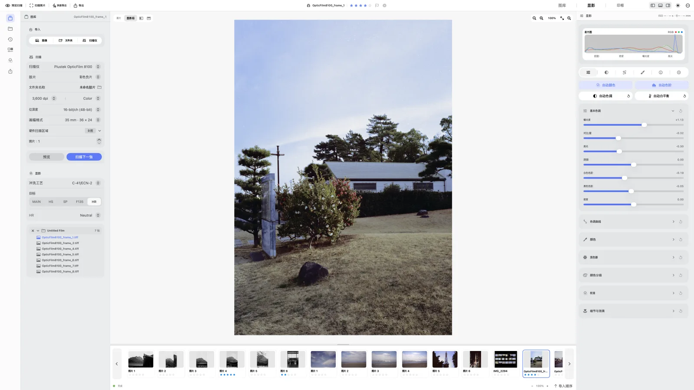
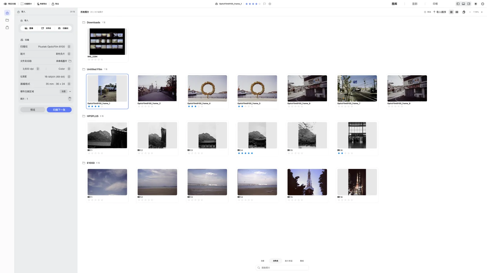
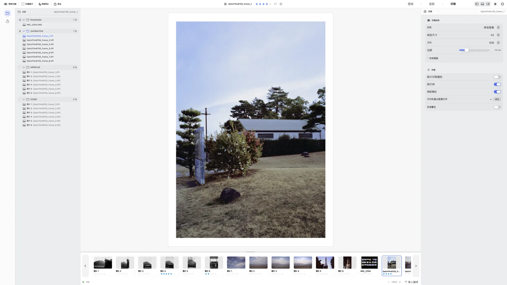

  

<h1 align="center">negaflow</h1>

从胶片到完成的照片。在 macOS 和 Windows 上各自原生运行。

  
  
  
  
  

  <a href="README.md">English</a> ·
  <a href="README_ko.md">한국어</a> ·
  <a href="README_ja.md">日本語</a> ·
  <strong>简体中文</strong> ·
  <a href="README_fr.md">Français</a> ·
  <a href="README_de.md">Deutsch</a>

  <a href="https://habinsong.github.io/negaflow-site/zh-Hans/">网站</a> ·
  <a href="https://habinsong.github.io/negaflow-site/zh-Hans/camera-scanning/">相机翻拍指南</a> ·
  <a href="https://habinsong.github.io/negaflow-site/zh-Hans/faq/">FAQ</a>

---

  <picture>
    <source media="(prefers-color-scheme: dark)" srcset="docs/images/zh-Hans/develop-dark.webp">
    
  </picture>

**negaflow** 可以对扫描或相机翻拍的胶片进行显影，支持彩色、黑白、负片和正片。整理照片、显影和印相都在同一个应用里完成。调整值单独保存，原始文件保持不变。

显影引擎叫 **Chroma Engine**，**GrainMend** 负责修复灰尘和划痕。没有扫描仪也可以导入图像文件，显影后导出。连接扫描仪需要单独安装插件。

> 和最近模拟热潮的增长不同，如今模拟摄影的流程可以说停滞了。除非用模拟的方式印相，否则胶片要经过转成数字的过程，才终于能被我们看见。
>
> 可是那整个过程都在停下来。冲扫店和实验室越来越少，厂商与产品的支持也在减少。
>
> 本项目起于我用这样那样的方式工作时感到的不便，以及觉得要是有这个功能就好了的想法。以使用 35mm 胶片和中画幅胶片时得到的经验和知识为基础，从一到十全都由我自己开发。一开始只是我一个人边用边做出来的小玩具项目，如今的 negaflow 已经成了不止于此的某种东西。
>
> 说到底最重要的是它「好」用、用着舒服、要够快，还有什么都自己妥当做出来的结果。独立开发的 **negaflow** 在 macOS 和 Windows 上各自原生运行，把冲扫店和个人的工作流都揉了进去。
>
>
> **谨以此夏，纪念尼埃普斯拍下第一张照片二百周年。** 2026年7月25日。

## negaflow for macOS and Windows

| | macOS | Windows |
|---|---|---|
| 界面 | SwiftUI | WinUI 3 |
| 引擎 | Swift + Core Image | C++ + Direct3D |
| 色彩管理 | ColorSync | Windows ICM |

两个应用都是原生应用，分别开发。语言和实现方式不同，同一个文件在两边得到同样的画面。引擎代码在 macOS 上是 `Chromabase` 模块，在 Windows 上是 `Native` 模块。

跨平台共用一套代码会影响速度和稳定性，所以没有采用，每个系统都从头单独实现。哪些相同、哪些不同，见 [macOS 版和 Windows 版的差异](docs/zh-Hans/platform/PLATFORM_DIFFERENCES.md)。

## 下载

从 [GitHub Releases](https://github.com/habinsong/negaflow/releases) 下载。

| 安装文件 | 适用环境 |
|---|---|
| `negaflow-1.2.6-mac-universal.pkg` | macOS 14 及以上，Apple Silicon 和 Intel |
| `negaflow-1.2.6-mac-arm64.pkg` | macOS 14 及以上，仅 Apple Silicon |
| `negaflow-1.2.6-win-x64.exe` | Windows 11 24H2 或更高，x64 |
| `negaflow-1.2.6-win-x64-setup.zip` | Windows 安装程序 ZIP |

兼容 macOS 14、26 和 27。

大多数 Mac 用 Universal PKG。同一页面还有仅适用于 Apple Silicon 的 PKG、DMG 和 ZIP。Mac 版是 ad hoc 签名，没有经过 Apple 公证。第一次运行时，在系统设置的隐私与安全性里点一次「仍要打开」。

Windows 安装程序装进用户文件夹，不要求管理员权限。它没有签名，SmartScreen 会拦一次：点「更多信息」再运行。卸载在控制面板里进行。校验和在发布页的 `SHA256SUMS.txt` 中。

连接扫描仪需要另外的插件。SANE 扫描仪用 [`negaflow-scanner-sane`](https://github.com/habinsong/negaflow-scanner-sane)，macOS 和 Windows 都能用。

## 功能

> 把模拟胶片变成成品照片所需的功能。

- 片基测量，彩色与黑白负片、正片显影
- 曝光、对比度、曲线、HSL 和调色
- 锐化、降噪、颗粒、暗角、光晕
- 去除灰尘和划痕的 GrainMend
- 图库：卷、文件夹、收藏集、星级、堆叠、虚拟副本，可按相机、镜头、胶片搜索
- 把显影流程、目标、影调、色彩、细节、裁剪和方向一起带走的预设与复制粘贴
- 导出 JPEG、PNG、16 位 TIFF 和 16 位线性 DNG，带 ICC 配置文件，相机、镜头、胶片等记录写入 EXIF
- 八种印相版式、纸张预览、照片用与 ISO 纸张，以及 C-print

## 1.2.6

- 修复了 HS、SP、F135、HR 目标的错误，并重做了它们的色彩渲染。
- 从 1.2 起，由于 RAW 处理改动，图库在 macOS 和 Windows 上都不支持高效率 NEF 文件。

## Chroma Engine

**Chroma Engine** 负责胶片的反相和显影。

显影负片之前，先在光线没有照到的区域测量片基。自动测量偏了，就用吸管点取，或直接输入 RGB 值。

默认是 `MAIN`，自动平衡为 ON。自动平衡是目标标题右侧的小胶囊开关，只在彩色和黑白负片的 MAIN（含 PRINT）和 CS 下显示。它依据当前照片调整颜色和亮度，OFF 时跳过这一步。自动色调、自动白平衡、自动色阶、自动颜色是独立功能，默认 OFF。

其余目标：`PRINT` 通过打印机 ICC 输出，`HS` 和 `SP` 属迷你冲扫系，`F135` 和 `HR` 属专业冲扫机系，`EXPIRED` 用来抢救老胶片，`CS` 收录 18 种自定义色彩风格。输出色彩空间可选 sRGB、Display P3、Adobe RGB，或自己的 RGB ICC 配置文件。

反相和色彩处理的顺序见 [Chroma Engine 文档](docs/zh-Hans/product/CHROMA_ENGINE.md)。

## GrainMend

> **GrainMend** 修复灰尘、针孔、划痕和乳剂损伤。

**GrainMend RGB** 是软件方式，不是硬件 IR。    
`自动` 不用标记，直接扫过整张照片，找出的结果里有一部分是误检。  
`引导` 只看指定的范围，对扫描时沾上的灰尘最有效。  
`画笔` 自己涂掉自动漏掉的地方。  
`克隆图章` 复制选定位置的像素，由你选好质感再涂上去。  

自动和引导先检查周围纹理的方向和结构，再用周围的纹理填补缺陷。把栏杆或砖缝当成划痕，它们就会从照片里消失。

修改结果以图层保留。可以调强度、查看蒙版，也可以逐个关闭或删除。 
**GrainMend IR** 把扫描仪插件传来的红外通道检测结果加进同一份记录。

**GrainMend IR** 使用扫描仪的红外通道(IR)。它不是 Digital ICE、iSRD、SRDx 的实现，也不是它们的兼容模式。工作方式和质量、性能标准见 [GrainMend 文档](docs/zh-Hans/product/GRAINMEND.md)。

## 从导入到印相

1. 导入图像文件，或者用装好的插件扫描。
2. 选择显影流程，指定扫描目标。
3. 在 Chroma Engine 里调整色彩和影调。
4. 给需要的照片使用 GrainMend。
5. 用对比视图和直方图确认后，印相或导出。

只导入不会显影。给文件夹选好流程和目标并点**应用**，或进入显影界面时才开始。另有一项设置可以自动开始，默认关闭。

每个操作对原始文件做了什么，见 [从图库到印相](docs/zh-Hans/product/WORKFLOW.md) 里的表格。

  <picture>
    <source media="(prefers-color-scheme: dark)" srcset="docs/images/zh-Hans/library-dark.webp">
    
  </picture>

  <picture>
    <source media="(prefers-color-scheme: dark)" srcset="docs/images/zh-Hans/print-dark.webp">
    
  </picture>

## 扫描仪与胶片配置文件

negaflow 只使用插件报告的分辨率、位深、扫描范围、曝光和 IR 支持，不会根据扫描仪型号推断功能。按名字猜，可能会打开设备上并不存在的功能。

SANE 设备由独立的 GPL 项目 [`negaflow-scanner-sane`](https://github.com/habinsong/negaflow-scanner-sane) 负责。插件在自己的进程里运行，交换格式是 JSON。**negaflow** 里没有 SANE 代码，也没有链接它。

内置 15 个扫描仪配置文件。HS 和 SP 目标是用 928 张个人照片的数据开发的，这些照片都用冲扫机（实验室扫描仪）扫描过。

配置文件由你自己选择，不会按扫描仪名字自动套用。

详细内容见[胶片配置文件文档](docs/zh-Hans/product/FILM_PROFILES.md)。

## 文档

- [Chroma Engine](docs/zh-Hans/product/CHROMA_ENGINE.md) | 片基、反相、色彩处理与显影顺序
- [GrainMend](docs/zh-Hans/product/GRAINMEND.md) | 缺陷检测与修复、IR、编辑记录
- [胶片配置文件](docs/zh-Hans/product/FILM_PROFILES.md) | 素材分析与配置文件生成
- [从图库到印相](docs/zh-Hans/product/WORKFLOW.md) | 导入、文件夹同步、批量显影、印相
- [产品结构](docs/zh-Hans/architecture/PRODUCT_ARCHITECTURE.md) | 应用、引擎、存储与导出结构
- [全部文档](docs/zh-Hans/README.md) | 6 种语言

## 自己构建

各平台所需的工具和命令不同，完整步骤在各自的文档里。[macOS](negaflow-mac/docs/README_zh-Hans.md) 需要 macOS 14 及以上和 Xcode 26 及以上。[Windows](negaflow-windows/docs/README_zh-Hans.md) 需要 Windows 11 24H2、Visual Studio 2026 和 .NET 10 SDK。仓库的工作规则见 [`CONTRIBUTING.md`](CONTRIBUTING.md)。

## 许可证

**negaflow** 以 [Apache License 2.0](LICENSE) 发布。与 Kodak、Fujifilm、Noritsu、LaserSoft Imaging 以及任何其他商标持有者都没有关联，也未获其赞助。产品名称只在指明兼容对象或测量对象时使用。详情见[商标声明](TRADEMARKS.md)。
