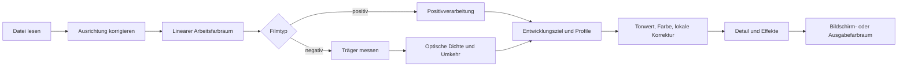

# Chroma Engine

[Dokumentationsstart](../README.md)

Die Chroma Engine kehrt Film um und entwickelt ihn. Der Code liegt im Modul `Chromabase`. App und CLI nutzen dasselbe Modul, gleiche Eingabe läuft also durch dieselbe Schrittfolge.

| Auf einen Blick | Inhalt |
|---|---|
| Standardentwicklung | `MAIN`, manuelle Korrektur |
| Filmträger | Automatische Messung, Pipette, direkte RGB-Eingabe |
| Farbe intern | Linearer Farbraum in 32-Bit-Gleitkomma |
| Automatikfunktionen | Nur wirksam, wenn Sie sie ausführen |
| Ausgabefarbraum | sRGB, Display P3, Adobe RGB, eigenes RGB-ICC |

> [!IMPORTANT]
> Auto Tone, Auto White Balance, Auto Levels und Auto Color schleichen sich nie in die Standardentwicklung.

## Was zuerst gilt

1. Lässt sich der Filmträger messen, schlägt die Messung den über den Namen gewählten Standardwert.
2. Filmeigenschaften, Scanlichtquelle, Scannerstil und automatische Szenenkorrektur bleiben getrennt.
3. Funktionen wie Auto Tone und Auto White Balance greifen nur, wenn Sie sie ausführen.
4. Gleiche Quelle, gleiche Bearbeitungswerte und gleiches Profilpaket durchlaufen dieselbe Schrittfolge.
5. Synthetische Tests und Prüfungen an echten Geräten gelten nie als derselbe Nachweis.

## Schrittfolge



Das Arbeitsbild läuft in einem linearen Farbraum mit 32-Bit-Gleitkomma. Nur Rechenschritte, die Gamma brauchen, wandeln an ihrer festen Stelle um. Die Kodierung für Bildschirm oder Dateiformat kommt zuletzt.

Apples Core-Image-Dokumentation:

- [CIImage](https://developer.apple.com/documentation/coreimage/ciimage)
- [CIContext](https://developer.apple.com/documentation/coreimage/cicontext)
- [workingColorSpace](https://developer.apple.com/documentation/coreimage/cicontext/workingcolorspace)
- [Core-Image-Leistungsleitfaden](https://developer.apple.com/library/archive/documentation/GraphicsImaging/Conceptual/CoreImaging/ci_performance/ci_performance.html)

`CIContext` wird nicht für jeden Render neu gebaut, sondern nach Zweck getrennt wiederverwendet: Anzeige, Analyse, Export. Die Vorschau rechnet nur die nötige Größe und die neueste Bearbeitungsversion. Der Export rendert erneut in Quellgröße.

## Filmträger

### Grund für die Messung

Der unbelichtete Teil eines Negativs ist ein Bezugspunkt aus Film, Entwicklung und Scanlichtquelle. Auch die Orangemaske des Farbnegativs steckt darin. Ist der Träger falsch, verschieben sich danach alle Dichten und Kanalverhältnisse.

Auch Kodaks Daten zu Portra 400 halten Mindestdichte, Kennlinien und spektrale Farbstoffdichte getrennt fest.

- [Kodak Professional Portra 400 technical data](https://www.kodakprofessional.com/sites/default/files/wysiwyg/pro/resources/e4050_portra_400.pdf)

### Automatische Messung

`FilmBaseEstimator` analysiert die räumliche Verteilung heller Pixel, um den unbelichteten Träger zu bestimmen.

- Ein Filmpixel kann nicht heller sein als der unbelichtete Träger.
- Deutlich Helleres kann Hintergrundlicht, Perforation oder außerhalb des Films sein.
- Ein echter Träger zieht sich meist als breites Band am Bildrand entlang.
- Liegen mehrere Filmstreifen auf einem Blatt, lassen sich getrennte Bereiche zusammen lesen.
- Einer Grenze, an der Halter und Film sich mischen, wird weniger getraut als dem Inneren.

Auf einem verkleinerten Analysebild wird die Helligkeitsverteilung gesucht, zusammenhängende Bereiche werden gruppiert, danach fallen Kandidaten außerhalb des Films weg. Bestehen mehrere Streifen die Bedingungen, werden sie gemeinsam gerechnet. Das Ergebnis hält auch die gewählte Methode und die Konfidenz fest.

### Die Methode wählen

| Modus | Verhalten |
|---|---|
| `Manual` | Nutzt das eingegebene RGB als Dmin. Eine erfolgreiche Pipette landet ebenfalls hier. |
| `Film` | Nutzt die Messung als Dmin; der gewählte Film liefert vor allem `dmaxNorm`. Film- und Lichtquellenvorgaben greifen nur, wenn die Messung scheitert. |
| `Auto` | Nutzt die räumliche Analyse und fällt bei Fehlschlag auf die randbasierte Methode zurück. |

Ohne manuellen Wert oder mit falscher Film-ID geht es zur nächsten sicheren Methode. Das hellste Objekt der Szene wird nie direkt als Filmträger genommen.

## Optische Dichte und Umkehr

Die Dichte ergibt sich aus der linearen Transmission `T` und dem Träger `Dmin` je Kanal.

```math
D = \log_{10}\left(\frac{D_{\min}}{T}\right)
```

`D = 0` heißt, die Eingabe entspricht dem unbelichteten Träger. Perforation oder Hintergrundlicht können negativ werden. Diese Werte bleiben endlich und werden nicht sofort beschnitten.

### Daten zu Filmtypen

Die aktuelle Tabelle führt 27 Filmnamen, darunter Farbnegative, Schwarzweiß und Kinonegative.

Wofür die Daten dienen:

- Der Dmin-Standardwert, wenn der Träger nicht messbar ist
- Feste relative Dichtefaktoren je Film

Manche Werte nähern Kurven aus öffentlichem Material an, manche sind bewusst konservativ gesetzt. 27 Namen bedeuten keine 27 geprüften Farbprofile. Sobald der Träger gemessen ist, gilt die Messung.

### Feste Printantwort

`fixed-density-linear-v6` gilt für negative `MAIN/PRINT` ohne Scannerprofil. Die Dichtekorrektur ist fest. Bei gleicher Basis und gleichen Einstellungen ändern andere Pixel, Ausschnitt oder Histogramm die Inversion derselben Transmission nicht. Szenenabhängige Vibrance wird nicht angewandt.

`B` ist die gemessene Basistransmission. `f` ist bei der generischen Antwort 1 oder der feste relative Bereichsfaktor des gewählten Films. `0.62` und `0.60D` sind Gamma- und Graudichtereferenzen des generischen Modells. Sie sind keine Messwerte jedes Films oder Scanners. Status-M-Dichten beschreiben Scanner-RGB nicht direkt.

```math
q_c = \log_{10}(B_c/\max(T_c,10^{-5}))/f_c,\quad k=0.045,\quad d_t=0.60+0.62\log_{10}(k/0.18),\quad p=d_t\ln(10)/0.62
```

```math
E_c=\begin{cases}
k\,\operatorname{sgn}(q_c)(|q_c|/d_t)^p,&q_c<d_t\\
0.18\times10^{(q_c-0.60)/0.62},&q_c\ge d_t
\end{cases}
```

Der Dichtefuß schließt mit gleichem Wert und gleicher Steigung an den geraden Abschnitt an. Die unbelichtete Filmbasis ergibt vor dem Weißabgleich eine Szenenbelichtung von null. Dieser Potenzfuß ist ein allgemeiner Entwurf, keine je Film gemessene Kurve. Nahe der Filmbasis kann er auch Dichterauschen verstärken.

Kanalweiser Weißabgleich und Belichtung wirken auf das szenenlineare `E`. Dieselbe feste Ausgabekurve wird nach dem Weißabgleich auf jeden Kanal angewendet. Der Mittelbereich erhält RGB-Verhältnisse; die Schulter verändert die Farbverhältnisse heller Bereiche. `0.045...0.70` bleibt identisch. Unter `0.045` wird ein kleiner Schwarzsockel addiert: `b=0.001` für Farbe und `0.0005` für Schwarzweiß. Über `0.70` nähert sich die rationale Schulter der 1. Beide Übergänge haben die Steigung 1. Die Umkehr des Filmfußes und die Schwarzdarstellung sind getrennte Schritte.

Die Inversion hat keine `1.8D`-Obergrenze. Die Transmissionsuntergrenze `1e-5` schützt den Logarithmus. Die Gamut-Abbildung erfolgt an der Ausgabegrenze. In diesem Schritt liegt jeder Kanal zwischen Schwarzsockel und 1. Spätere manuelle Korrekturen können diesen Bereich überschreiten.

[fixed-density-linear-v6](../reference/PRINT_RESPONSE.md)

## Drei Arten von Profilen

| Art | Welche Frage sie beantwortet | Werte |
|---|---|---|
| Film stock | Wie sehen Träger und Dichtebereich dieses Films aus | Dmin/Dmax, Filmtyp |
| Light source | Wie wirkte die Scanlichtquelle auf jeden Kanal | Kanal-Gain, trägerbasierte Korrektur |
| Scanner target | Welchen Ton- und Farbstil hat das Ergebnis | Relative Statistik aus eigens erstellten Scans |

Diese Trennung verhindert den Fehler, einen Filmnamen zugleich für Emulsionseigenschaften, Lichtquellenfarbe und den Ausgabestil eines Labors stehen zu lassen. Liegt ein echter Träger vor, gilt die Messung vor den Vorgaben der Lichtquelle. Auch Scannerstatistiken dienen nicht direkt als absolute Farbmatrix einer Szene.

Die Daten beschreibt [Filmprofile](FILM_PROFILES.md).

## Entwicklungsziele

### `MAIN`

Das Standardziel verwendet eine feste Dichtekalibrierung und eine feste kanalweise Ausgabekurve. Auto-Pegel, Auto-Farbe, Auto-Ton und automatischer Weißabgleich werden nur auf Wunsch ausgeführt.

### `PRINT`

Das Arbeitsbild entspricht `MAIN`. Am Ende des Exports wird einmal ein gültiges RGB-Drucker-ICC angewendet. Fehlt das Profil oder ist es ungültig, scheitert der Lauf, statt auf sRGB oder beliebige Papierwerte auszuweichen.

### `HS`, `SP`

Zwei Stufen.

1. `documentedCharacter`: `SP` ist ein entworfener Charakter: eine filmartige Kurve, die Fuß und Schulter staucht und die Mitten steiler macht, neutrale Schatten mit leicht warmen Lichtern, warme Farben nach vorn und kühle Farben vertieft, dazu Farbdichte, die gesättigte Farben etwas abdunkelt. `HS` baut Ton-, Neutral- und Farbcharakter aus veröffentlichter Richtung und den Entwurfswerten des Projekts.
2. `scannerSignature`: Hinzu kommt nur die relative Differenz jener Gruppen, deren Filmnamen und Bildzahlen auf beiden Maschinen übereinstimmen. `SP` fügt sie nur hinzu, wenn Sie eines seiner mitgelieferten Profile wählen.

`HS` enthält eine Schärfung im Helligkeitskanal. Radius und Stärke stammen nicht aus einer Messung an der echten Maschine. `SP` enthält sie nicht; stattdessen legt die Texturstufe vor Ihrer eigenen Klarheit einen leichten lokalen Kontrast an.

Alle heutigen Profile sind `realOnly`.

- Die relative Differenz entsteht nur, wenn Filmnamen und Bildzahlen hinreichend übereinstimmen.
- Werte, deren Richtung kippt, werden nicht angewendet.
- Bei Schwarzweiß entfallen die Farbanteile.
- Stimmt der SHA-256 einer Datei oder eines Manifests nicht, wird das ganze Profilpaket abgelehnt.

### `F135`, `HR`

Das sind zwei vom Projekt entwickelte Minilab-Stile. `F135` nutzt eine printnahe S-Kurve mit warmen Mitten, `HR` tiefe Schwarztöne und eine ruhige neutrale, bläuliche Richtung. Es wird nicht behauptet, eine bestimmte Maschine geprüft und nachgebaut zu haben.

### `EXPIRED`

Ein Rettungsziel für alten Film. Es entsättigt nicht pauschal und dehnt den Bereich nicht, sondern bleibt bei begrenzten Korrekturen im Rahmen der vorhandenen Belege.

## Der Filmlook auf digitalem Ausgangsmaterial

Der Film-Tab links bietet Dia- und Farbnegativmaterial an. Bei einem Scan genügt dafür eine Farbtransformation, denn Belichtungsspielraum, Dichteverlauf, Streuung und Korn des Films stecken bereits in den Pixeln.

Einer digitalen Aufnahme fehlt das alles. Wir haben gemessen, was eine reine Farbtransformation dort anrichtet: Auf kameraseitig gerendertem Material fielen die Abstände in den Lichtern auf 0,0031, ein Vierzehntel desselben Werts bei flachem Ausgangsmaterial, während die Sättigung trotzdem stieg. Das Ergebnis liest sich als Filter, nicht als Film.

Material, das als `Digital Color` oder `Digital B&W` markiert ist, läuft deshalb durch eine eigene Kette, die der Reihe nach nachholt, was der Film tut.

1. Das Display-Rendering der Kamera zurückrechnen, um die Belichtung zu schätzen, die der Film bekommen hätte. Beschnittene Details kommen nicht zurück; das ist eine plausible Rekonstruktion, keine Wiederherstellung.
2. Streuung und Halation hinzufügen, solange das Bild noch lineares Licht ist und noch keine Dichte existiert. Zurückkehrendes Licht trifft zuerst die Rotschicht, das Leuchten fällt also rötlich aus, und das Licht wird umverteilt statt addiert.
3. Virtuelle Entwicklung. Eine Schwärzungskurve baut Dichte auf, DIR-Kuppler hemmen die Nachbarschichten, und ein Negativ geht anschließend über RA-4-Papier. Das niedrige Gamma des Negativs und das hohe Gamma des Papiers sind zwei getrennte Kurven; deshalb legen sich die Lichter hin, statt abzureißen.
4. Die Farbsignatur der Emulsion, denn der Kontrast entstand schon in Schritt 3.
5. Korn, das der Dichte folgt, und Kantenverhalten nach der MTF des Datenblatts.

Gescanntes Material betritt diese Kette nie. Es entscheidet allein die Kennzeichnung der Quelle, der Scan-Pfad bleibt unverändert.

Die Belichtung wird auf den Spielraum der jeweiligen Emulsion umskaliert. Ein Umkehrfilm ist etwa eine Blende über Mittelgrau schon weiß; schiebt man eine digitale Szene mit sechs Blenden unverändert hinein, bleibt in den Lichtern keinerlei Zeichnung. Die Umskalierung erhält die Kontrast-Rangfolge der Emulsionen, statt alle Filme auf dieselbe Kennlinie zu ziehen.

Sobald eine Emulsion gewählt ist, werden Korn und Halation zu Eigenschaften des Films. Die Textur-Regler bestimmen deshalb deren Stärke und legen keinen zweiten, eigenen Effekt darüber.

## Entwicklungsregler

| Gruppe | Elemente |
|---|---|
| Tonwert | Belichtung, Kontrast, Lichter, Schatten, Weiß, Schwarz, RGB- und kanalweise Punktkurven |
| Farbe | Temperatur, Tönung, Dynamik, Sättigung, HSL in 8 Farben, Colorgrading in drei Zonen, Kanalkorrektur, Schwarzweißumsetzung und Tonung |
| Detail und Effekte | Schärfe, Klarheit, Dunst entfernen, Filmkorn, Vignette, Halation, Rauschminderung |
| Lokale Korrektur | Radiale, lineare, polygonale und Pinselmasken sowie Abwedeln und Nachbelichten |

Diese Werte werden als schrittweiser Bearbeitungsverlauf gespeichert. GrainMend und gewöhnliche lokale Korrektur unterscheiden sich in Zweck und Speicherform.

## Farbmanagement

Trägt die Eingabe ein gültiges ICC, wird dieser Farbraum gelesen. Die interne Rechnung läuft im festgelegten linearen Arbeitsraum; der Wechsel in einen Ausgabefarbraum geschieht bei Anzeige, Softproof und Export.

Wichtige unterstützte Ausgaben:

- sRGB
- Display P3
- Adobe RGB
- Ein vom Nutzer gewähltes RGB-Drucker-/Ausgabe-ICC

Name, Bytezahl und SHA-256 des Druckerprofils werden zu Beginn des Exports festgehalten. Ändert sich die Datei während des Renderns, bricht der Lauf ab.

Es wird nicht behauptet, dass der heutige Weg über Core Image und ColorSync auf jedem macOS Rendering Intent und Black Point Compensation bitgleich erzeugt. Dafür bräuchte es zuerst einen eigenen ColorSync-Pufferweg und Speicherprüfungen für große 16-Bit-Bilder.

## Ausgabekodierung

Formateinstellungen liegen außerhalb der Farbpipeline, entscheiden aber darüber, was in der ausgelieferten Datei übrig bleibt.

JPEG speichert Farbe mit geringerer Auflösung als Helligkeit, sofern der Encoder nicht über seine Unterabtastungsschwelle hinaus geführt wird. Darunter wird die Chrominanz horizontal und vertikal halbiert: Helligkeitsdetails bleiben erhalten, gesättigte Kanten werden weicher. Qualität ab 95 % wird deshalb ohne Chroma-Unterabtastung kodiert. Niedrigere Einstellungen behalten den gewählten Wert, denn wer sie wählt, will eine kleinere Datei.

PNG und TIFF sind verlustfrei und tasten nie unter. Ihr einziger Qualitätsregler ist die Bittiefe, 8 oder 16 Bit pro Kanal. Dithering wird nur bei 8 Bit angewendet, wo es Quantisierungsbanding verdeckt.

## Leistung und Sicherheit

- `CIContext` wird je Zweck wiederverwendet.
- Beim Regeln läuft eine Vorschau in geringerer Auflösung; der Export baut aus der Quelle neu auf.
- Ein Ergebnis, das lange gedauert hat, prüft kurz vor der Anwendung Bild-ID, Bearbeitungsversion und Sitzung erneut.
- Wird der Speicher knapp, fallen Caches wie Miniaturen und Vorschauen weg.
- Originale und Bearbeitungsverlauf bleiben von Caches getrennt.

## Prüfstufen

1. Formeltests: Monotonie der Kurve, Ankerpunkte, Umkehrfunktion
2. Synthetische Bilder: bekannte Ein- und Ausgabe, Beschnitt, Ausrichtung, Farbraum
3. Synthetisches IT8: der mathematische Hin- und Rückweg über 264 Felder
4. Statistik echter Aufnahmen: die `realOnly`-Profile
5. REAL/TARGET-Paare: eine Gerätequalitätsprüfung mit eigenem Prüfmaterial
6. Prüfung an echter Hardware: Scanner, Film, Display und Ausdruck

Ein gutes Ergebnis im synthetischen IT8 belegt keine absolute Genauigkeit an echten Negativen. Für die Qualität von Scannerprofilen gelten [Qualitätsprüfung der Scannerprofile](../reference/PROFILE_QUALITY_GATE.md) und [IT8-Farbprüfung](../reference/IT8_COLOR_VALIDATION.md).

## Wo der Code liegt

- `Sources/Chromabase/Engine/`
- `Sources/Chromabase/Film/`
- `Sources/Chromabase/Develop/`
- `Sources/Chromabase/Adjustments/`
- `Sources/Chromabase/Profiles/`
- `Sources/Chromabase/Imaging/`
- `Sources/Chromabase/Export/`

Die aktuelle Produktversion ist `1.2.0`. Bearbeitungsverlauf und Profilschemata werden auch künftig erst nach einem Prüfverfahren geändert.
