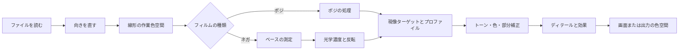

# クロマエンジン

[ドキュメントホーム](../README.md)

クロマエンジンはフィルムを反転して現像します。コードは`Chromabase`モジュールにあります。 アプリとCLIが同じモジュールを使うので、入力が同じなら同じ処理順を通ります。

| ひと目で | 内容 |
|---|---|
| 既定の現像 | `MAIN`、手動補正 |
| フィルムベース | 自動測定、スポイト、RGBの直接入力 |
| 内部の色処理 | 32-bit浮動小数点の線形色空間 |
| 自動機能 | 実行したときだけ適用 |
| 出力の色空間 | sRGB、Display P3、Adobe RGB、ユーザーのRGB ICC |

> [!IMPORTANT]
> 自動トーン、自動ホワイトバランス、自動レベル、自動カラーが既定の現像に紛れ込むことはありません。

## 先に守ること

1. フィルムベースを測れるなら、名前で選んだ既定値より測定値を先に使います。
2. フィルムの物性、スキャンの光源、スキャナーのスタイル、場面の自動補正を混ぜません。
3. 自動トーンや自動ホワイトバランスのような機能は、実行したときだけ効かせます。
4. 同じ原本、編集値、プロファイル一式には同じ処理順を使います。
5. 合成テストと実機での検証を同じ証拠として語りません。

## 処理の順序



作業画像は32-bit浮動小数点の線形色空間で処理します。 ガンマが要る演算だけ、決められた段階で変換します。 画面やファイル形式に合わせたエンコードは最後です。

AppleのCore Imageの説明:

- [CIImage](https://developer.apple.com/documentation/coreimage/ciimage)
- [CIContext](https://developer.apple.com/documentation/coreimage/cicontext)
- [workingColorSpace](https://developer.apple.com/documentation/coreimage/cicontext/workingcolorspace)
- [Core Imageの性能指針](https://developer.apple.com/library/archive/documentation/GraphicsImaging/Conceptual/CoreImaging/ci_performance/ci_performance.html)

`CIContext`はレンダーのたびに作り直しません。表示、解析、書き出しの用途に分けて使い回します。 プレビューは必要な大きさと最新の編集バージョンだけ計算します。書き出しは原寸で作り直します。

## フィルムベース

### 測る理由

ネガの未露光部分は、フィルム、現像工程、スキャンの光源が合わさった基準点です。 カラーネガのオレンジマスクもここに入っています。 ベースを間違えると、その後の濃度とチャンネルの関係が全部ずれます。

Kodak Portra 400の資料も、最小濃度、特性曲線、色素の分光濃度を別々に記録しています。

- [Kodak Professional Portra 400 technical data](https://www.kodakprofessional.com/sites/default/files/wysiwyg/pro/resources/e4050_portra_400.pdf)

### 自動測定

`FilmBaseEstimator`は明るいピクセルの空間分布を分析して未露光ベースを特定します。

- フィルムのピクセルは未露光ベースより明るくなれません。
- はるかに明るい場所は、バックライト、パーフォレーション、フィルムの外かもしれません。
- 実際のベースは、フレームの縁に幅広く続く傾向があります。
- 1枚にフィルムストリップが複数あれば、離れた領域も一緒に見られます。
- ホルダーとフィルムが混じる境界は、内側より信用しません。

縮小した解析画像で明るさの分布を探し、つながった領域をまとめ、フィルム外の候補を外します。 条件を通ったストリップが複数あれば一緒に計算します。結果には、選んだ方法と信頼度も残します。

### 方法の選び方

| モード | 動き |
|---|---|
| `Manual` | 入力したRGBをDminとして使います。スポイトが成功したときもこのモードになります。 |
| `Film` | 測定値をDminにして、選んだフィルムは主に`dmaxNorm`を出します。フィルムと光源の既定値は測定に失敗したときだけ使います。 |
| `Auto` | 空間解析を使い、失敗したら縁を基準にした方法へ下がります。 |

手動の値がない、またはフィルムIDが誤っていれば、次の安全な方法へ移ります。 場面でいちばん明るい被写体を、そのままフィルムベースにすることはありません。

## 光学濃度と反転

線形の透過率`T`とチャンネルごとのベース`Dmin`から濃度を出します。

```math
D = \log_{10}\left(\frac{D_{\min}}{T}\right)
```

`D = 0`は、入力が未露光ベースと同じという意味です。 パーフォレーションやバックライトは負になり得ます。 その値も有限のまま扱い、その場で切り捨てません。

### フィルム種別の資料

いまの表には、カラーネガ、白黒、映画用ネガなど27のフィルム名があります。

この資料の使いどころ:

- ベースを測れないときのDminの既定値
- フィルム別の固定相対濃度係数

一部の値は公開資料の曲線を読んで近似し、一部は保守的に取りました。 27の名前が、検証済みの色プロファイル27個を意味するわけではありません。 ベースを測ったなら、実測値が優先です。

### 固定プリント応答

`fixed-density-linear-v6` はスキャナープロファイルのないネガの `MAIN/PRINT` に適用します。密度補正値は固定です。ベースと設定が同じなら、周囲の画素、クロップ、ヒストグラムを変えても同じ透過率の反転結果は変わりません。シーン別の vibrance は適用しません。

`B` は測定したフィルムベースの透過率です。`f` は汎用応答では 1、フィルム選択時は固定の相対範囲係数です。`0.62` と `0.60D` は汎用モデルのガンマとグレー密度の基準です。各フィルムやスキャナーの測定値ではありません。Status M 密度をスキャナー RGB に直接置き換えることもできません。

```math
q_c = \log_{10}(B_c/\max(T_c,10^{-5}))/f_c,\quad k=0.045,\quad d_t=0.60+0.62\log_{10}(k/0.18),\quad p=d_t\ln(10)/0.62
```

```math
E_c=\begin{cases}
k\,\operatorname{sgn}(q_c)(|q_c|/d_t)^p,&q_c<d_t\\
0.18\times10^{(q_c-0.60)/0.62},&q_c\ge d_t
\end{cases}
```

フィルム濃度のトウは値と傾きを合わせて直線部につなぎます。未露光ベースはWB前のシーン露光0に反転します。このべき乗トウは汎用設計であり、フィルム別の実測曲線ではありません。ベース付近では濃度ノイズも増幅し得ます。

チャンネルWBと露光はシーンリニアの `E` に適用します。WB後に同じ固定出力曲線を各チャンネルへ適用します。中間域ではRGB比を保ち、ショルダーではハイライトの色比が変わります。`0.045...0.70` は恒等です。`0.045` 未満では小さな黒レベルを加えます。カラーの `b` は `0.001`、白黒は `0.0005` です。`0.70` より上は有理関数のショルダーで1に近づけます。接続点の傾きはどちらも1です。フィルムトウの逆変換と出力の黒処理を分けています。

逆変換に `1.8D` 上限はありません。透過率の `1e-5` 下限は対数演算を保護します。色域処理は出力境界で行います。この段階の各チャンネルは黒レベルと1の間です。その後の手動補正では範囲を超える場合があります。

[fixed-density-linear-v6](../reference/PRINT_RESPONSE.md)

## プロファイルは3種類

| 種類 | 答える問い | 値 |
|---|---|---|
| Film stock | そのフィルムのベースと濃度範囲は | Dmin/Dmax、フィルム種別 |
| Light source | スキャンの光源が各チャンネルにどう効いたか | チャンネルのgain、ベース基準の補正 |
| Scanner target | 結果のトーンと色のスタイルは | 自分で撮ったスキャンの相対統計 |

この3つを分けておけば、フィルム名1つが乳剤の物性、光源の色、ラボの仕上がりを全部表すという誤りを避けられます。 実測のベースがあれば、光源の既定値より測定値を使います。 スキャナーの統計も、場面の絶対的な色行列としてそのまま使うことはしません。

データの詳細は[フィルムプロファイル](FILM_PROFILES.md)にあります。

## 現像ターゲット

### `MAIN`

既定の現像ターゲットです。固定の濃度補正とチャンネル別の固定出力曲線を使います。自動レベル、自動カラー、自動トーン、自動WBは明示的に有効にした場合だけ適用します。

### `PRINT`

作業画像は`MAIN`と同じです。書き出しの最後に、有効なRGBのprinter ICCを一度だけ当てます。 プロファイルがない、または不正なときは、sRGBや適当な紙の値で代用せず失敗させます。

### `HS`、`SP`

2段階で処理します。

1. `documentedCharacter`: `SP`は設計した性格です。トウとショルダーを抑えて両端の階調を圧縮し中間を立てたフィルム型のカーブ、中立なシャドウとわずかに暖かいハイライト、暖色を前に・寒色を深くする色の対比、濃い色を少し深くする色密度でできています。 `HS`は、公開されている方向とプロジェクトの設計値でトーン、中立、色の性格を作ります。
2. `scannerSignature`: 両方の機材でロール名と画像数が合うグループの相対差だけを足します。 `SP`は同梱プロファイルを自分で選んだときだけ足します。

`HS`には明るさチャンネルのシャープニングが入ります。実機の半径と強さを測った値ではありません。 `SP`には入れず、代わりにテクスチャ段階でユーザーの明瞭度の前に弱い部分コントラストをかけます。

いまのプロファイルはすべて`realOnly`です。

- ロール名と画像数が十分に合うときだけ相対差を計算します。
- 向きが反転する値は当てません。
- 白黒では色成分を外します。
- ファイルや目録のSHA-256が1つでも違えば、プロファイル一式を拒否します。

### `F135`、`HR`

プロジェクトが作った2つのミニラボ風スタイルです。 `F135`は印画寄りのS字カーブと暖かい中間調、`HR`は深い黒と落ち着いた中立・青方向を使います。 特定の機材を検証して複製したとは主張しません。

### `EXPIRED`

古いフィルム向けの復旧ターゲットです。 無条件に彩度を落としたり範囲を伸ばしたりせず、いまの根拠の範囲で限られた補正だけを行います。

## デジタル素材でのフィルムルック

左の Film タブにはスライドとカラーネガのストックがあります。 スキャン素材ではこれは色変換だけで足ります。フィルムのラチチュード、濃度応答、散乱、粒子がすでにピクセルの中に入っているからです。

デジタル写真にはそのどれもありません。 色変換だけを載せたときに何が起きるかを測りました。カメラが仕上げた入力ではハイライトの階調差が 0.0031 まで潰れ、同じ条件のフラット入力の 14 分の 1 でした。それでいて彩度は逆に上がりました。 結果がフィルムではなくフィルターに見えるのはこのためです。

そこで `Digital Color`、`Digital B&W` と印を付けた素材は、フィルムがやることを順にやり直す別の経路を通ります。

1. カメラがかけた表示用のレンダリングをほどき、フィルムが受けるはずの露光を推定します。 クリップして消えた情報は戻りません。復元ではなく、もっともらしい再構成です。
2. まだ線形の光の状態、濃度が生まれる前に散乱とハレーションを載せます。 戻ってきた光は赤の層に先に当たるので赤く滲み、光量を足さずに配り直します。
3. 仮想現像。特性曲線で濃度を作り、DIR カプラーが隣の層を抑え、ネガは RA-4 のプリントまで進みます。ネガの低いガンマと印画紙の高いガンマは別々の二本の曲線で、ハイライトが切れずに寝るのはここに理由があります。
4. ストック固有の色のくせ。コントラストは 3 の段階でもう作られています。
5. 濃度に従う粒子と、データシートの MTF によるエッジ応答。

スキャン素材はこの経路を通りません。 分岐は素材の印ひとつで決まり、スキャンの経路はそのままです。

露光は乳剤ごとのラチチュードに合わせて取り直します。リバーサルは中間グレーの一段ほど上でもう白なので、6 段あるデジタルの場面をそのまま押し込むとハイライトに階調が残りません。 この取り直しはすべてのフィルムを同じ応答にせず、ストックごとのコントラストの序列を保ちます。

ストックを選ぶと粒子とハレーションは乳剤の性質になります。そのためテクスチャーのスライダーは別の効果を足すのではなく、その強さを決めます。

## 現像の調整

| まとまり | 項目 |
|---|---|
| トーン | 露出、コントラスト、明部、暗部、白、黒、RGBとチャンネル別のポイントカーブ |
| 色 | 色温度、色かぶり、自然な彩度、彩度、HSL 8色、3領域のカラーグレーディング、チャンネル補正、白黒変換とトーニング |
| ディテール・効果 | シャープネス、明瞭度、かすみ除去、フィルムグレイン、周辺光量、ハレーション、ノイズ除去 |
| 部分補正 | 円形、線形、多角形、ブラシのマスクと覆い焼き・焼き込み |

これらの値は段階ごとの編集履歴として保存します。 GrainMendと普通の部分補正は、目的も保存の仕方も違います。

## カラーマネジメント

入力に有効なICCがあれば、その色空間を読みます。 内部の計算は決めた線形の作業色空間で行い、画面、ソフトプルーフ、書き出しの段階で出力の色空間へ移します。

主な対応出力:

- sRGB
- Display P3
- Adobe RGB
- ユーザーが選んだRGBのprinter/output ICC

プリンタープロファイルの名前、バイト数、SHA-256は、書き出しの開始時に固定します。 レンダー中にファイルが変わったら中断します。

いまのCore ImageとColorSyncの経路が、すべてのmacOSでレンダリングインテントとblack-point compensationをビット単位で同じにする、とは主張しません。 その保証が要るなら、別のColorSync バッファ経路と、大きな16-bit画像のメモリ検査が先に必要です。

## 出力エンコード

フォーマット設定はカラーパイプラインの外にありますが、配布されるファイルに何が残るかを決めます。

JPEG は、エンコーダーのサブサンプリングしきい値を超えないかぎり、色を輝度より低い解像度で保存します。そこから下では色の解像度が水平・垂直とも半分になり、輝度のディテールはそのままに彩度の高い境界がにじみます。そのため品質 95% 以上はクロマサブサンプリングなしでエンコードします。 それより低い設定は選んだ値をそのまま使います。低い品質を選ぶ意図はファイルを小さくすることだからです。

PNG と TIFF は可逆でサブサンプリングをしません。画質を決める値はチャンネルあたり 8bit か 16bit のビット深度だけです。ディザリングは量子化バンディングを隠す 8bit のときにのみ適用します。

## 性能と安全

- `CIContext`は用途ごとに使い回します。
- 調整中は低い解像度のプレビューを使い、書き出しは原本から作り直します。
- 時間のかかった結果は、適用の直前にフレームID、編集バージョン、セッションを確認し直します。
- メモリが足りないときは、サムネイルやプレビューなどのキャッシュを空けます。
- 原本と編集履歴は、キャッシュと分けて保存します。

## 検証の段階

1. 数式のテスト: 曲線の単調性、基準点、逆関数
2. 合成画像: 既知の入出力、クリッピング、向き、色空間
3. 合成IT8: 264パッチの数学的な往復
4. 実撮影の統計: `realOnly`のプロファイル
5. REAL/TARGETのペア: 別の検証資料を伴う装置の品質検査
6. 実機の確認: 実際のスキャナー、フィルム、画面、出力物

合成IT8の結果が良くても、実際のネガの絶対的な正確さを示すわけではありません。 スキャナープロファイルの品質判断は[プロファイル品質判定](../reference/PROFILE_QUALITY_GATE.md)と [IT8色検査](../reference/IT8_COLOR_VALIDATION.md)に従います。

## コードの場所

- `Sources/Chromabase/Engine/`
- `Sources/Chromabase/Film/`
- `Sources/Chromabase/Develop/`
- `Sources/Chromabase/Adjustments/`
- `Sources/Chromabase/Profiles/`
- `Sources/Chromabase/Imaging/`
- `Sources/Chromabase/Export/`

いまの製品バージョンは`1.2.0`です。 編集履歴とプロファイルのスキーマは、以降のバージョンでも検証の手順を経てから変えます。
