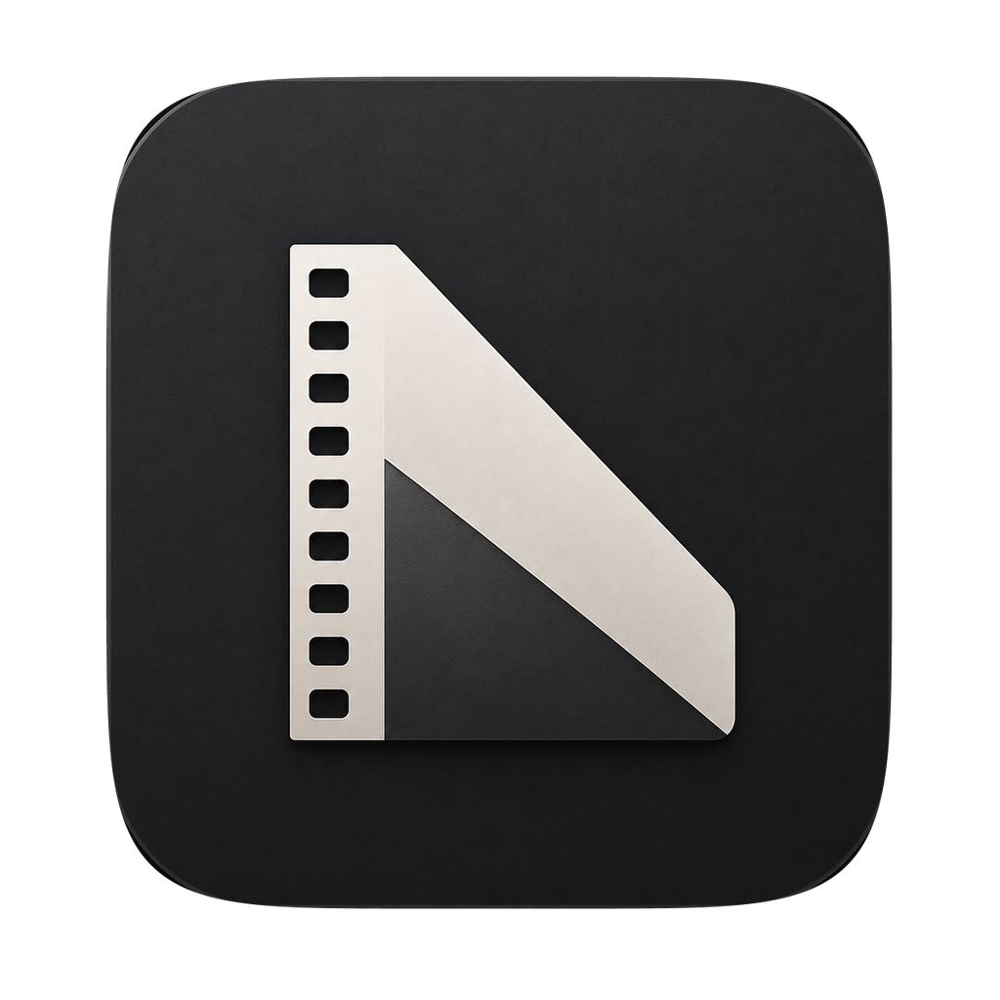

<p align="center">
  
</p>

<h1 align="center">negaflow for macOS</h1>

<p align="center">negaflow, nativ für macOS gebaut.</p>

<p align="center">
  <a href="#"></a>
  <a href="#"></a>
  <a href="../../LICENSE"></a>
</p>

<p align="center">
  <a href="README.md">English</a> ·
  <a href="README_ko.md">한국어</a> ·
  <a href="README_ja.md">日本語</a> ·
  <a href="README_zh-Hans.md">简体中文</a> ·
  <a href="README_fr.md">Français</a> ·
  <strong>Deutsch</strong>
</p>

<p align="center">
  <a href="../../README_de.md">Gemeinsame Dokumentation</a> ·
  <a href="../../negaflow-windows/docs/README_de.md">Windows</a>
</p>

---

## Voraussetzungen

Zum Ausführen:

- macOS 14.0 oder neuer (macOS 14, 15, 26 und 27 werden unterstützt)
- Apple Silicon oder Intel
- 8 GB Arbeitsspeicher, für Mittelformat 16 GB empfohlen

Zum Bauen:

- Xcode 26 oder neuer für die App
- Swift 5.9 oder neuer für Engine und CLI

## Installation

Download unter [Releases](https://github.com/habinsong/negaflow/releases).

| Datei | Unterstützte Macs |
|---|---|
| `negaflow-1.2.7-mac-universal.pkg` | Apple Silicon, Intel |
| `negaflow-1.2.7-mac-arm64.pkg` | Nur Apple Silicon |

Das Universal-PKG passt für die meisten Macs und installiert nach `/Applications`. Auf derselben Seite liegen ein DMG und ein ZIP, falls Sie die App selbst ablegen wollen.

Die App ist ad hoc signiert und nicht notarisiert, deshalb blockiert macOS den ersten Start. Erlauben Sie sie in den Systemeinstellungen unter Datenschutz & Sicherheit mit Trotzdem öffnen.

Mediathekskatalog, Defekt-Sidecars, Rezepte und Abzugsvorlagen liegen in `~/Library/Application Support/negaflow`, während die App-Einstellungen in `UserDefaults` (`~/Library/Preferences/com.songhabin.negaflow.plist`) gespeichert werden.

Beim Start fragt die App GitHub einmal nach der neuesten Veröffentlichung. Gibt es eine neuere Version, steht unten im ⋯-Menü oben rechts „Auf Version X.Y.Z aktualisieren“. Ein Klick öffnet die Release-Seite und lädt das passende PKG für diesen Mac in den Ordner „Downloads“, geprüft gegen die `SHA256SUMS.txt` des Releases. Installieren Sie es selbst. Ist die App aktuell, lautet der Eintrag „Sie haben die neueste Version.“ und öffnet die Projektseite. Schlägt die Prüfung fehl, etwa offline, erscheint der Eintrag nicht.

## Build

```bash
git clone https://github.com/habinsong/negaflow.git
cd negaflow/negaflow-mac

# Release-App bauen und starten
bash scripts/run-app.sh

# Nur bauen, nicht starten
bash scripts/run-app.sh build
```

`run-app.sh` ruft `xcodebuild` auf, setzt das App-Bundle zusammen und signiert es lokal. Für Engine oder CLI allein genügt `swift build`.

Release-Artefakte (baut die Bundles `arm64` und `universal` und erzeugt über `create-release-artifacts.sh` PKG und DMG, ZIP und dSYM sowie `SHA256SUMS.txt`):

```bash
bash scripts/build-release.sh
```

## Prüfungen

```bash
# Swift-Tests
DEVELOPER_DIR=/Applications/Xcode.app/Contents/Developer swift test

# Release-Build der App
bash scripts/run-app.sh build

# Statische Prüfungen und Swift-CI (NEGAFLOW_CI_GUI=1 baut die GUI-Tests, NEGAFLOW_CI_GUI_RUN=1 führt sie aus)
bash scripts/ci-gate.sh
```

## Eigene Farbziele

CS steht nach MAIN und HS sowie SP, F135 und HR in den Zielkapseln. Die Auswahl öffnet im Auswahlfeld unten links eine zweispaltige Liste mit 18 Custom-Zielen; die Look-Auswahl bleibt rechts. Beim Wechsel zu CS wird Emulsion gewählt, ein Bild mit Custom-Ziel behält sein Ziel.

Die Liste hat drei Gruppen: Emulsion bis Dichroic (11), Wetzlar bis Rochester (4), Slide Show bis Point & Shoot (3). Custom-Ziele wenden die Antwort von custom-3 für Tonwert, Dichte und Chroma an. Speichern, Vorschauen, Miniaturen und Export verwenden die ID des gewählten Ziels. Die übrigen Ziele bleiben unverändert.

Die CLI nimmt dieselben IDs: `--target classic`, `--target dye-transfer`, `--target point-and-shoot`.

## Befehlszeile

Das macOS-Swift-Paket enthält ein CLI-Target, das mit `swift build` gebaut wird.

```bash
swift build

# Scanner finden
.build/debug/negaflow detect
.build/debug/negaflow capabilities <scannerID>

# Entwickeln
.build/debug/negaflow develop in.tiff out.jpg --look rich-neutral --target main

# GrainMend
.build/debug/negaflow develop scan.tif out.jpg --defects 1
.build/debug/negaflow defect-bench ./scans --out ./report

# Profile und Selbsttest der Engine
.build/debug/negaflow list-scanner-profiles
.build/debug/negaflow selftest
```

Alle Optionen zeigt `negaflow` ohne Argumente.

## Scanner

Scanner-Bedienelemente bleiben verborgen, bis ein Plug-in installiert ist. SANE-Geräte übernimmt [`negaflow-scanner-sane`](https://github.com/habinsong/negaflow-scanner-sane), das separat installiert wird.

## Module

| Modul | Aufgabe |
|---|---|
| `Chromabase` | Chroma Engine und GrainMend, Profile und Export |
| `ScannerKit` | Prüfung der Scanner-Fähigkeiten und Plug-in-Anbindung |
| `negaflowApp` | Ansichten für Mediathek und Entwickeln, Abzug, Scannen und Exportieren |
| `negaflowCLI` | Befehle zum Entwickeln, Scannen, Benchmarken und für den Selbsttest |

## Referenzbilder

`docs/verification/macos-golden` enthält Bilder, die dieser Build gerendert hat. Git ignoriert den Ordner, die Bilder liegen also nur auf dem Rechner, der sie erzeugt hat. Die Windows-Engine-Tests vergleichen pixelgenau mit Kopien davon. Erzeugen Sie die Bilder nur neu, wenn sich die macOS-Ausgabe ändern soll.

## Weitere Dokumente

- [Wo sich die beiden Versionen unterscheiden](../../docs/de/platform/PLATFORM_DIFFERENCES.md)
- [Chroma Engine](../../docs/de/product/CHROMA_ENGINE.md)
- [GrainMend](../../docs/de/product/GRAINMEND.md)
- [Produktstruktur](../../docs/de/architecture/PRODUCT_ARCHITECTURE.md)
