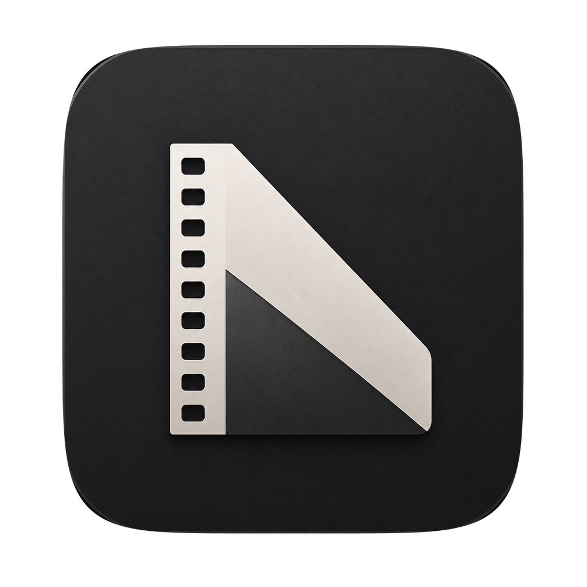

<p align="center">
  
</p>

<h1 align="center">negaflow for macOS</h1>

<p align="center">macOS 네이티브로 만든 negaflow입니다.</p>

<p align="center">
  <a href="#"></a>
  <a href="#"></a>
  <a href="../../LICENSE"></a>
</p>

<p align="center">
  <a href="README.md">English</a> ·
  <strong>한국어</strong> ·
  <a href="README_ja.md">日本語</a> ·
  <a href="README_zh-Hans.md">简体中文</a> ·
  <a href="README_fr.md">Français</a> ·
  <a href="README_de.md">Deutsch</a>
</p>

<p align="center">
  <a href="../../README_ko.md">공통 문서</a> ·
  <a href="../../negaflow-windows/docs/README_ko.md">Windows</a>
</p>

---

## 필요한 환경

실행:

- macOS 14.0 이상 (macOS 14부터 27까지 지원)
- Apple Silicon 또는 Intel
- 메모리 8GB, 중형 필름은 16GB 권장

빌드:

- 앱: Xcode 26 이상
- 엔진과 CLI: Swift 5.9 이상

## 설치

[Releases](https://github.com/habinsong/negaflow/releases)에서 받습니다.

| 파일 | 지원하는 Mac |
|---|---|
| `negaflow-1.2.7-mac-universal.pkg` | Apple Silicon, Intel |
| `negaflow-1.2.7-mac-arm64.pkg` | Apple Silicon 전용 |

대부분의 Mac에서는 `/Applications`에 바로 설치되는 Universal PKG를 선택하면 됩니다. 앱을 직접 옮기려면 배포 페이지의 DMG나 ZIP을 받으세요.

앱은 ad hoc 서명이고 공증을 받지 않아서 첫 실행을 macOS가 막습니다. 시스템 설정의 개인정보 보호 및 보안에서 '그래도 열기'를 누르세요.

라이브러리 카탈로그, 결함 사이드카, 레시피, 인화 템플릿은 `~/Library/Application Support/negaflow`에 있고 앱 환경설정은 `UserDefaults`(`~/Library/Preferences/com.songhabin.negaflow.plist`)에 저장됩니다.

앱은 실행할 때 한 번 GitHub에 최신 릴리즈를 묻고, 새 버전이 있으면 오른쪽 위 ⋯ 메뉴 맨 아래에 "X.Y.Z 버전 업데이트"를 보여 줍니다. 항목을 누르면 릴리즈 페이지가 열리면서 이 Mac에 맞는 PKG를 릴리즈의 `SHA256SUMS.txt`로 검증한 뒤 다운로드 폴더에 받아 두므로 설치만 직접 마치면 됩니다.

이미 최신이면 메뉴 문구가 "현재 최신 버전입니다."로 바뀌어 프로젝트 페이지로 연결되고, 오프라인 상태에서 확인이 실패하면 그 항목은 메뉴에서 빠집니다.

## 빌드

```bash
git clone https://github.com/habinsong/negaflow.git
cd negaflow/negaflow-mac

# Release 앱을 빌드하고 실행
bash scripts/run-app.sh

# 실행 없이 빌드만
bash scripts/run-app.sh build
```

`run-app.sh`는 `xcodebuild`를 부르고 앱 번들을 조립해 로컬 서명을 마칩니다. 엔진이나 CLI만 빌드할 때는 `swift build`만 실행하세요.

배포 파일(`arm64`와 `universal` 번들을 빌드하고 `create-release-artifacts.sh`를 호출해 PKG와 DMG 설치본, ZIP과 dSYM 아카이브, `SHA256SUMS.txt` 생성):

```bash
bash scripts/build-release.sh
```

## 점검

```bash
# Swift 테스트
DEVELOPER_DIR=/Applications/Xcode.app/Contents/Developer swift test

# 앱 Release 빌드
bash scripts/run-app.sh build

# 정적 검사와 Swift CI 검사 (GUI 테스트 빌드는 NEGAFLOW_CI_GUI=1, 실행은 NEGAFLOW_CI_GUI_RUN=1)
bash scripts/ci-gate.sh
```

## Custom 색 타깃

타깃 캡슐에는 기본 타깃 다섯 개(MAIN, HS, SP와 F135, HR) 뒤에 CS가 놓입니다. CS를 고르면 왼쪽 아래 선택기가 Custom 타깃 18개를 2열 목록으로 보여 주고, 룩 선택기는 오른쪽에 그대로 남습니다. CS에 들어가면 Emulsion이 기본으로 선택되지만 이미 Custom 타깃이 지정된 사진은 기존 선택을 유지합니다.

목록은 세 그룹으로 구성되어 Emulsion부터 Dichroic까지 11개, Wetzlar부터 Rochester까지 4개, Slide Show부터 Point & Shoot까지 3개가 들어갑니다. Custom 타깃은 custom-3 톤과 농도, 채도 응답을 반영하므로 저장과 미리보기부터 썸네일과 내보내기까지 모두 선택한 타깃 ID를 참조하며, 나머지 기본 타깃은 기존 경로를 그대로 따릅니다.

CLI도 똑같은 ID를 받습니다: `--target classic`, `--target dye-transfer`, `--target point-and-shoot`.

## 명령줄

macOS Swift 패키지에는 `swift build`로 빌드하는 CLI 타깃이 들어 있습니다.

```bash
swift build

# 스캐너 찾기
.build/debug/negaflow detect
.build/debug/negaflow capabilities <scannerID>

# 현상
.build/debug/negaflow develop in.tiff out.jpg --look rich-neutral --target main

# GrainMend
.build/debug/negaflow develop scan.tif out.jpg --defects 1
.build/debug/negaflow defect-bench ./scans --out ./report

# 프로파일과 엔진 자체 점검
.build/debug/negaflow list-scanner-profiles
.build/debug/negaflow selftest
```

전체 옵션은 인수 없이 `negaflow`를 실행해 확인하세요.

## 스캐너

플러그인을 설치해야 스캐너 컨트롤이 화면에 나타납니다. SANE 장치는 따로 설치하는 [`negaflow-scanner-sane`](https://github.com/habinsong/negaflow-scanner-sane)이 맡습니다.

## 모듈

| 모듈 | 역할 |
|---|---|
| `Chromabase` | Chroma Engine과 GrainMend, 프로파일과 내보내기 |
| `ScannerKit` | 스캐너 기능 확인과 플러그인 연결 |
| `negaflowApp` | 라이브러리와 현상, 인화 화면과 스캔/내보내기 |
| `negaflowCLI` | 현상과 스캔, 벤치마크와 자체 점검 명령 |

## 기준 이미지

`docs/verification/macos-golden`에는 이 빌드가 만든 이미지가 들어 있으며, Git이 무시하므로 이미지를 생성한 컴퓨터에만 보관됩니다. Windows 엔진 테스트가 그 복사본과 픽셀 단위로 비교하기 때문에 macOS 출력을 의도적으로 바꿀 때만 다시 생성하세요.

## 관련 문서

- [두 버전의 차이](../../docs/ko/platform/PLATFORM_DIFFERENCES.md)
- [Chroma Engine](../../docs/ko/product/CHROMA_ENGINE.md)
- [GrainMend](../../docs/ko/product/GRAINMEND.md)
- [제품 구조](../../docs/ko/architecture/PRODUCT_ARCHITECTURE.md)
