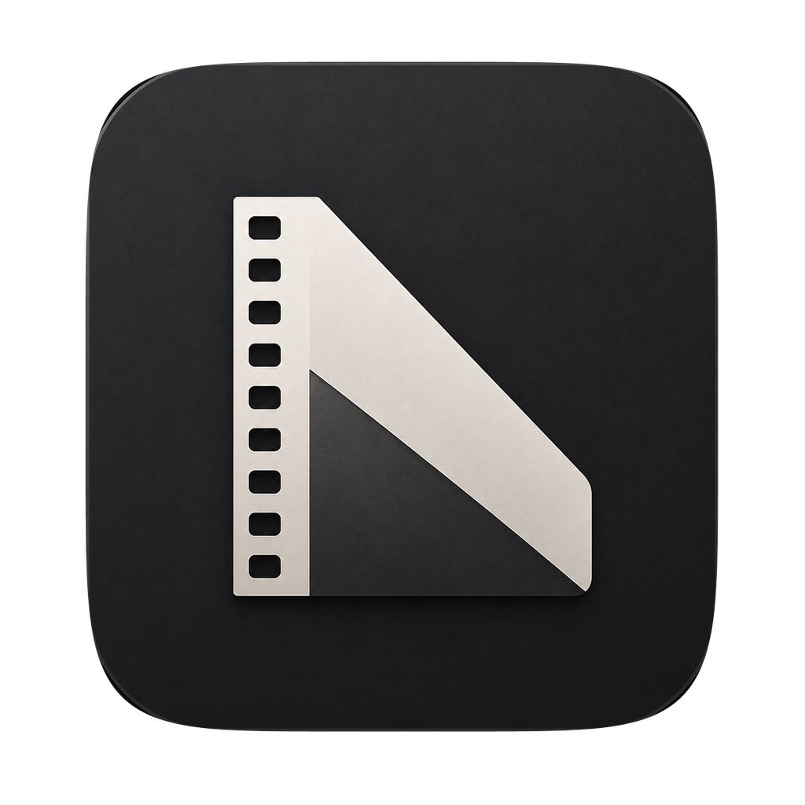

<p align="center">
  
</p>

<h1 align="center">negaflow for Windows</h1>

<p align="center">Windows 네이티브로 만든 negaflow입니다.</p>

<p align="center">
  <a href="#"></a>
  <a href="#"></a>
  <a href="../../LICENSE"></a>
</p>

<p align="center">
  <a href="README.md">English</a> ·
  <strong>한국어</strong> ·
  <a href="README_ja.md">日本語</a> ·
  <a href="README_zh-Hans.md">简体中文</a> ·
  <a href="README_fr.md">Français</a> ·
  <a href="README_de.md">Deutsch</a>
</p>

<p align="center">
  <a href="../../README_ko.md">공통 문서</a> ·
  <a href="../../negaflow-mac/docs/README_ko.md">macOS</a>
</p>

---

## 필요한 환경

실행:

- Windows 11 24H2(빌드 26100) 이상, 64비트
- 메모리 8GB, 중형 필름은 16GB 권장

빌드:

- Visual Studio 2026, C++ 데스크톱·.NET 데스크톱·WinUI/Windows 앱 개발 워크로드 포함 (정확한 구성 요소는 `.vsconfig`에 있음)
- Windows 11 SDK 10.0.26100 이상
- .NET 10 SDK (`global.json`이 10.0.302로 고정)
- CMake 4.2 이상 (`Visual Studio 18 2026` 생성기가 요구)
- Python 3 (아이콘과 리소스 스크립트용)

빌드에는 Arm64 프리셋도 있습니다. 배포 파일은 x64만 올립니다.

## 설치

[Releases](https://github.com/habinsong/negaflow/releases)에서 `negaflow-1.2.7-win-x64.exe`를 받아 실행하세요. 기본 설치 위치는 `%LOCALAPPDATA%\Negaflow\App`이고 서명되지 않은 루스 앱 패키지 등록(`AllowDevelopmentWithoutDevLicense`)이 아직 허용되지 않은 PC에서만 관리자 확인을 한 번 요청합니다.

[negaflow-1.2.7-win-x64-setup.zip](https://github.com/habinsong/negaflow/releases/download/v1.2.7/negaflow-1.2.7-win-x64-setup.zip)은 설치 파일 압축본으로 똑같은 설치 EXE와 안내문, 고지문, SHA-256 체크섬이 들어 있으니 압축을 모두 푼 뒤 설치 파일을 실행하세요.

설치 파일에는 인증서 서명이 들어가 있지 않아서 처음 실행할 때 SmartScreen이 한 번 경고하므로, 추가 정보를 누른 뒤 실행하면 됩니다.

제거는 시작 메뉴의 `Uninstall negaflow`나 설정의 앱 목록에서 처리하며 라이브러리와 사진은 그대로 남습니다.

앱은 실행할 때 한 번 GitHub에 최신 릴리즈를 묻는데 새 버전이 있으면 오른쪽 위 ⋯ 메뉴 맨 아래에 "X.Y.Z 버전 업데이트"를 표시합니다. 항목을 누르면 릴리즈 페이지가 열리면서 `win-x64.exe` 설치 파일을 릴리즈의 `SHA256SUMS.txt`로 검증한 뒤 다운로드 폴더에 받으므로 설치는 사용자가 직접 마치면 됩니다.

이미 최신이면 메뉴 문구가 "현재 최신 버전입니다."로 바뀌어 프로젝트 페이지로 연결되고 오프라인 상태에서 확인이 실패하면 그 항목은 메뉴에서 빠집니다.

## 빌드

```powershell
git clone https://github.com/habinsong/negaflow.git
cd negaflow\negaflow-windows

# C++ 엔진 빌드
.\scripts\build.ps1 -Preset x64-release

# 앱을 빌드하고 실행
.\scripts\run-app.ps1 -Architecture x64 -Configuration Release
```

`build.ps1`은 `x64-debug`, `x64-release`, `arm64-debug`, `arm64-release`를 받습니다.

개발 중에는 앱이 MSIX 패키지로 빌드되어 빌드 폴더의 exe만 단독으로 띄울 수 없으므로 항상 `run-app.ps1`을 거칩니다. 스크립트가 패키지를 빌드하고 현재 사용자에게 등록한 뒤 앱 ID로 실행합니다.

설치 파일 빌드:

```powershell
.\scripts\build-release.ps1 -Architecture x64
```

결과물은 `out\release\win-x64`에 생깁니다.

## 점검

```powershell
# C++ 엔진 테스트
ctest --preset x64-release --output-on-failure

# 앱과 카탈로그 테스트
.\scripts\test-managed.ps1

# 엔진과 앱 경계 테스트 (따로 실행)
.\scripts\test-interop.ps1

# CI 게이트(번역 키, 슬라이더 범위, CTest, 관리 코드 테스트), 배포 빌드, 설치 파일 검증
.\scripts\local-ci.ps1
```

`scripts\verify-installer.ps1`(`local-ci.ps1`도 부릅니다)은 로그인한 데스크톱 세션에서 실행하세요. SSH 세션에서는 AppX 등록이 `0x80070005`로 실패할 수 있어, 스크립트는 기존 설치를 건드리기 전에 멈춥니다.

CI는 자체 완결형 엔진 검증만 수행하며 macOS 골든 파일은 Git 밖에 둡니다. macOS 골든 대조를 실행하려면 CMake를 구성할 때 `NEGAFLOW_MACOS_GOLDEN_ROOT`에 `task6-metadata-policy`, `task9-bw-slide`, `task7-coreimage-filters`, `task8-digital-film-look`, `vibrance`가 들어 있는 기준 폴더를 지정하세요.

파일이 빠졌거나 읽히지 않으면 그 대조가 실패로 처리되며, `ctest --preset x64-release -L external-golden`으로 골든 검증을 실행하는 동안에도 일반 단위 테스트는 함께 활성 상태로 유지됩니다.

## Custom 색 타깃

타깃 캡슐에는 MAIN과 HS, SP, F135, HR 뒤에 CS가 놓입니다. CS를 고르면 왼쪽 아래에 Custom 타깃 18개가 11개와 4개, 3개 세 그룹의 2열 목록으로 열리고 룩 선택기는 오른쪽에 그대로 남습니다. CS에 들어가면 Emulsion이 기본으로 선택되지만 이미 Custom 타깃이 지정된 사진은 기존 선택을 유지합니다.

Custom은 macOS와 똑같은 custom-3 계수와 문자열 ID를 따릅니다. 고른 타깃은 사진 설정과 카탈로그에 저장되고 미리보기와 내보내기가 똑같은 단계를 거칩니다. 폴더 머리글에서는 기존 적용 버튼으로 고른 타깃을 폴더에 반영합니다.

## 명령줄로 엔진 확인

`negaflow-cli.exe`는 파일 한 개에 엔진을 실행해 보는 도구이며 하위 명령 대신 플래그를 받습니다.

```powershell
$cli = "out\build\native\x64-release\Release\negaflow-cli.exe"

# 빌드 정보
& $cli --build-info

# 스캔 파일의 내용
& $cli --probe-tiff scan.tif

# 현상해서 16비트 TIFF로 저장 (<dmin-r> <dmin-g> <dmin-b> <color|bw>)
& $cli --export-developed-tiff16 scan.tif out.tif 0.85 0.55 0.35 color

# 현상 한 번에 걸리는 시간의 내역
& $cli --develop-timing scan.tif

# 필름 베이스 자동 측정과 선택된 값
& $cli --auto-base-probe scan.tif
```

인수 없이 실행하면 빌드 정보 JSON을 출력하고, 옵션 목록은 `--help`로 확인합니다.

## 스캐너

플러그인을 설치해야 스캐너 컨트롤이 화면에 나타납니다. SANE 장치는 따로 설치하는 [`negaflow-scanner-sane`](https://github.com/habinsong/negaflow-scanner-sane)이 맡습니다.

플러그인은 Windows가 이미 제공하는 드라이버 경로로 스캐너와 통신하므로 PC에 설치된 VueScan이나 SilverFast도 충돌 없이 동작합니다.

## 문제가 생겼을 때

앱의 텍스트 로그는 `%LOCALAPPDATA%\Negaflow\Logs`에 쌓입니다.

| 파일 | 기록하는 것 |
|---|---|
| `export-trace.txt` | 내보내기와 빠른 내보내기, 실패 포함 |
| `termination.txt` | 앱이 닫히는 동안 일어난 일 |
| `settings-change.txt` | 바뀐 설정과 바꾼 주체 |
| `startup-trace.txt` | 시작과 셸 초기화 단계 |
| `crop-trace.txt` | 크롭 기하와 조작 갱신 |

위 로그는 항상 켜져 있습니다(오류가 나면 `native-crash.txt`나 `scanner-failure.txt`처럼 장애 로그도 함께 기록됨). 아래 선택 로그는 기본값이 꺼짐입니다.

- `preview-trace.txt`, `thumbnail-trace.txt`, `shortcut-trace.txt`, `decode-trace.txt`, `memory-budget.txt`: 로그 폴더에 대응하는 `.on` 표식 파일(`preview-trace.on`, `thumbnail-trace.on`, `shortcut-trace.on`, `decode-trace.on`, `memory-trace.on`)을 만들거나 설정에서 개발자 모드를 켜면 기록됩니다.
- `stage-trace.txt`, `stage-timing.txt`: 앱을 실행하기 전에 환경 변수 `NEGAFLOW_STAGE_TRACE=1`(단계별 픽셀 통계) 또는 `NEGA_TIMING=1`(단계별 소요 시간)을 지정하세요.

## 구성

```
negaflow-windows/
├── src/
│   ├── Native/        Chroma Engine, GrainMend, 디코딩과 내보내기 (C++)
│   ├── Interop/       엔진과 앱 사이의 계층 (C#)
│   ├── Catalog.Core/  라이브러리 저장 (C#)
│   ├── Shell.Core/    현상, 인화, 스캔, 내보내기 로직 (C#)
│   ├── Shell/         라이브러리, 현상, 인화, 스캔 화면 (WinUI 3)
│   └── Cli/           엔진 점검 도구 (C++)
├── scripts/           빌드, 테스트, 패키징 스크립트
├── tests/             엔진, 앱, 경계 테스트
└── Installer/windows/ NSIS 설치 프로그램
```

## 관련 문서

- [두 버전의 차이](../../docs/ko/platform/PLATFORM_DIFFERENCES.md)
- [Chroma Engine](../../docs/ko/product/CHROMA_ENGINE.md)
- [GrainMend](../../docs/ko/product/GRAINMEND.md)
- [제품 구조](../../docs/ko/architecture/PRODUCT_ARCHITECTURE.md)
